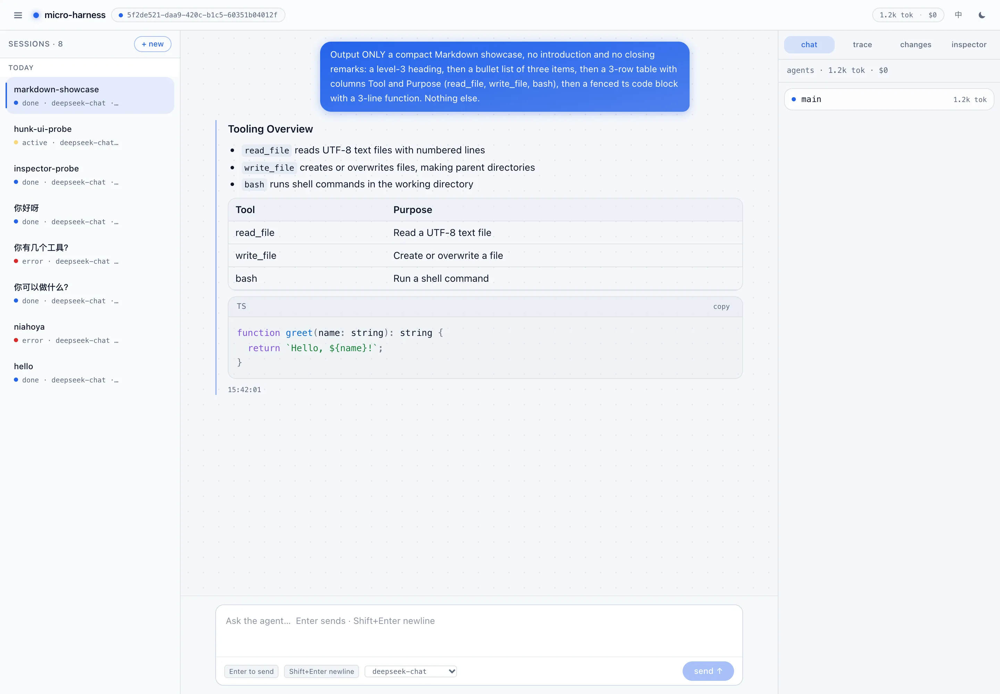
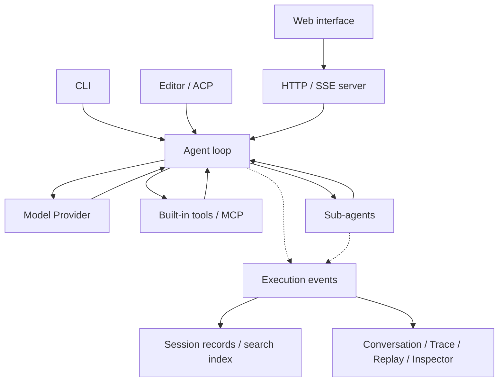

<!-- 品牌图标使用透明背景，适配深浅主题。 -->
<p align="center">
  
</p>

<h1 align="center">micro-harness</h1>

<p align="center"><strong>Put models to work on code. See how the work gets done.</strong></p>
<p align="center">Run locally · Coordinate agents · Review changes · CLI and web interface</p>

<p align="center">
  <strong>English</strong> · <a href="README.zh-CN.md">简体中文</a> · <a href="https://alexzhangupupup.github.io/micro-harness/">Documentation</a>
</p>

<p align="center">
  <a href="https://github.com/AlexZhangUPUPUP/micro-harness/actions/workflows/ci.yml"></a>
  
  <a href="LICENSE"></a>
</p>

micro-harness is a coding-agent runtime built with TypeScript. An *agent harness* is the layer between a model and a project: it runs the tool loop, manages the context window and records what happened. This one is small enough to read — **4 packages, ~12k lines, zero runtime dependencies**, with no framework between the model and the loop.

Connect any OpenAI Chat Completions–compatible service to read projects, edit files, run tools and delegate to sub-agents. The CLI, HTTP server and web interface share the same kernel. The six-file seed it grew from is frozen at [`seed-v1`](https://github.com/AlexZhangUPUPUP/micro-harness/tree/seed-v1) — the shortest path to understanding the loop.

<!-- 星标动图链接到仓库，点击图片不会自动更改账号的 Star 状态。 -->
<p align="center">
  <a href="https://github.com/AlexZhangUPUPUP/micro-harness">
    
  </a>
</p>

<p align="center">If this helps, give micro-harness a star.</p>

## Why use it

- **A kernel you can read.** The loop, tool dispatch, compaction and event stream are ordinary code in `packages/core` (~5k lines). No plugin container, no framework — you can follow a request from `send()` to the model call and back.
- **One event stream, four views.** The same tagged events are the session log, the SSE feed, replay, Trace and Inspector. “What the model saw” is recorded, not reconstructed from a separate UI state.
- **Capability *is* the permission model.** `read-only` / `workspace` / `full` / `auto-review` decide which tools exist, whether the shell is available, and whether `network` tools need approval per call.
- **Delegation with a review step.** Sub-agents get separate context (optionally a git worktree); their diffs land hunk by hunk, and a drifted hunk is reported rather than mis-applied.
- **Tests and evals as first-class.** 212 tests, a 26-task eval suite, a deterministic `--mock` mode and a golden set with judge calibration — all runnable offline.

<!-- 产品静态截图独立展示，避免与星标引导混淆。 -->
<p align="center">
  
</p>

<p align="center"><em>Submit a task, follow its execution, and inspect the result in one interface.</em></p>

[Core design](#core-design) · [How it compares](#how-it-compares) · [Quick start](#quick-start) · [CLI and editors](#cli-and-editors) · [Working with multiple agents](#working-with-multiple-agents) · [Configuration and limitations](#configuration-and-limitations) · [Tests and evals](#tests-and-evals) · [Architecture and documentation](#architecture-and-documentation) · [Development and contributing](#development-and-contributing)

## Core design

| Design | How it works | Implementation |
|---|---|---|
| **One execution event contract** | Model requests, tool results, usage, and sub-agent status travel as events tagged with agent identity. Logs, SSE, and the interface consume those events. | [Event definitions](packages/core/src/events.ts), [agent loop](packages/core/src/harness.ts) |
| **Replaceable capability interfaces** | The loop calls models through `Provider`, executes operations through `Tool`, and accesses files through `FileSystem`. Capabilities are composed explicitly in code. | [Model interface](packages/core/src/provider.ts), [tool interface](packages/core/src/tools.ts), [file interface](packages/core/src/fs.ts) |
| **Context compaction that respects message structure** | The default keeps the first and recent turns while dropping the middle. Long single turns can be trimmed by tool step, keeping calls paired with their results. Model-written summaries are also supported. | [Context policies](packages/core/src/context.ts), [mechanism tests](packages/core/test/context.test.ts) |
| **Separate collaboration state and code changes** | Sub-agents have independent conversations. Optional Git worktrees separate working directories, with diffs and hunk selection for integration. See [configuration](#configuration-and-limitations) for boundaries. | [Agent runner](packages/core/src/agents.ts), [isolation and integration](packages/core/src/isolation.ts), [patch application](packages/core/src/patch.ts) |

Project instructions live in the working directory: if `AGENTS.md` exists, its contents are appended to the system prompt (capped at 8,000 characters). The Inspector shows the exact prompt a run received, so you can confirm what the model was told. Prompt templates in `prompts/` or `commands/` appear as `/name` in the composer (the server expands `/name args`), and skills in `skills/<name>/SKILL.md` are appended to the system prompt; the CLI and the web UI read the same files.

The execution path connects entry points to recorded events. Solid arrows show requests or execution; dotted arrows show event output.



## How it compares

Different harnesses optimise different parts of the same problem: Codex has an OS sandbox, Claude Code has the deepest product surface, pi has the largest runtime extension surface, and opencode has the most complete client/server split. DeepSeek Harness (dsh) composes capabilities through Cordis plugins, including a replaceable agent loop. The difference here is at the kernel.

| | micro-harness | DeepSeek Harness (dsh) | pi | Codex | Claude Code | opencode |
|---|---|---|---|---|---|---|
| **Kernel** | ~12k lines TS, 4 packages, no runtime deps | Cordis plugin runtime | small TS loop + extension API | Rust `core` + `tui`/`exec`/`app-server` | closed source | TS server + protocol + clients |
| **Owns the loop** | `Harness` | replaceable `core/agent-loop` driver | yes, deliberately small | `codex-core` | — | the server |
| **Extension unit** | compile-time interfaces + MCP at boot | Cordis plugins + profiles / bundles | TypeScript extensions at startup | MCP + `AGENTS.md` + config | hooks / skills / sub-agents | plugins + server protocol |
| **Events** | one stream = log, SSE, replay, Inspector | durable session events + live extension events | session JSONL + RPC/SDK | `app-server` JSON-RPC | — | server protocol |
| **Boundary** | presets × approval × tool `network` flag | sandbox backends + tool execution policy | extension-defined | OS sandbox + approval | permission modes | config |
| **Surface** | CLI · server + GUI · ACP · MCP | Web · headless · SDK · ACP · desktop | TUI · RPC · SDK | CLI · TUI · app-server · MCP | CLI · IDE | CLI/TUI · desktop · server |

The DeepSeek Harness column was checked on **2026-10-17** against its [official architecture documentation](https://github.com/deepseek-ai/deepseek-harness/blob/master/docs/architecture.md). Both projects emphasize events and capability interfaces; dsh composes its runtime through plugins and configuration, while this project assembles interfaces explicitly in code.

`—` means the project does not document it, not that it is absent. This is a dated snapshot; corrections are welcome.

What is **not** a difference: having a server with SSE (opencode does), supporting MCP (Codex and Claude Code do), or offering extensions (pi’s surface is much larger). What is: a kernel small enough to read end to end, a compile-time seam instead of a plugin runtime — so no hot-plug, by design — and an event stream that is simultaneously the log, the replay source and the UI feed. The [design notes](docs/design-comparison.md) go through the trade-offs question by question.

## Quick start

You need [Bun](https://bun.sh) ≥ 1.1 and an API key for your model service. Worktree isolation also requires Git and a target project that is a Git repository.

### 1. Get the project and configure a model

```bash
# Clone the project and install dependencies.
git clone https://github.com/AlexZhangUPUPUP/micro-harness.git
cd micro-harness
bun install

# DeepSeek shown as an example; use your own key.
export MICRO_BASE_URL=https://api.deepseek.com
export MICRO_API_KEY=your-api-key
export MICRO_MODEL=deepseek-chat
```

For another compatible service, change the URL, key, and model ID together. For example, OpenAI uses `https://api.openai.com/v1`. See [.env.example](.env.example) for configuration fields.

### 2. Open the web interface

```bash
# Auto-review: the shell works, but every command asks first.
MICRO_PERMISSION=auto-review bun run ui
```

The first launch builds the interface and opens your browser, normally at `http://127.0.0.1:8787`. If the port is occupied, the launcher picks another one; use the URL printed in your terminal. Use the composer's **Stop** button (or `Esc`) to interrupt a run, and `Ctrl-C` to stop the process.

Try a small task:

> Create hello.txt containing hello from micro-harness, then read the file and tell me its contents.

When it finishes, `hello.txt` should exist in the working directory, and the conversation should show the write, read, and final reply. The default working directory is where you launch the command; the startup output shows it as `cwd`.

### 3. Use it on your own project

From the micro-harness repository, pass the absolute path to your project:

```bash
# Replace with the path to your project.
MICRO_CWD=/absolute/path/to/your-project MICRO_PERMISSION=auto-review bun run ui
```

Alternatively, install the two launch commands:

```bash
# Installs to ~/.local/bin, which must be on PATH.
./scripts/install.sh

# Enter the target project, then start the interface.
cd /absolute/path/to/your-project
MICRO_PERMISSION=auto-review microh
```

`micro-harness` is the compiled CLI. `microh` is a web launcher pointing to this source checkout; it still needs Bun and the checkout.

### Serve tools to another agent

`micro-harness mcp` speaks MCP over stdio, so another agent (or an MCP client) can call this harness's file tools — the mirror image of the editor case above.

```bash
# file tools only; the shell stays off for an external caller
micro-harness mcp --dir /absolute/path/to/your-project

# add the shell explicitly
micro-harness mcp --dir /absolute/path/to/your-project --allow-bash
```

Register it like any stdio MCP server (`command: "micro-harness"`, `args: ["mcp", "--dir", "…"]`).

### What a run records

For the file task in Quick start, the model issues a `write_file` call, the runtime executes it and returns the result, then the model reads the file and replies. The exact tool sequence depends on the model.

Each `model.request` records the messages handed to the Provider after compaction and the tool names. `tool.call` / `tool.result` record arguments, output, and duration; `usage` records provider-reported token usage. Compare Inspector, Trace, and the file on disk to check what the model received and what it actually did.

## CLI and editors

### Work in the terminal

From the repository root:

```bash
# Run one task, or start interactive mode.
bun start "Read this project and summarize its entry points and main modules"
bun start

# The shell is on by default; auto-edit asks before each command.
bun start "Run the relevant tests and analyze failures"

# Point at the target project.
bun start --dir /absolute/path/to/your-project "Explain this project's structure"
```

After installation, replace `bun start` with `micro-harness`. Run `bun start --help` for the full options, or enter `/help` in interactive mode for commands, prompt templates, and skills.

### Connect an editor

The ACP (Agent Client Protocol) entry point lets a compatible editor drive the agent:

```bash
# Launch through the wrapper script, suitable for an editor.
/absolute/path/to/micro-harness/scripts/acp.sh
```

<details>
<summary>Example custom-agent configuration for Zed</summary>

Replace the path below with the absolute path to your checkout. The wrapper reads `~/.micro-harness/env`; if no key is available, it also tries the DeepSeek key in `~/.pi/agent/auth.json`.

```json
{
  "agent_servers": {
    "micro-harness": {
      "type": "custom",
      "command": "/absolute/path/to/micro-harness/scripts/acp.sh",
      "args": []
    }
  }
}
```

Choose `micro-harness` in the Agent Panel to start a session. When the client advertises file read/write capabilities, the agent can access files through the editor, including unsaved buffers. Directory listings still use the local disk.

</details>

## Working with multiple agents

The main agent delegates through the `task` tool. Each sub-agent gets its own conversation context, receives a task description, and returns its final result. This is useful for code research, independent implementation tasks, or exploring alternatives.

**Conversation contexts are separate by default. File isolation is opt-in.** To give sub-agents separate Git worktrees:

```bash
# Enable isolation on a Git project and open the web interface.
MICRO_CWD=/absolute/path/to/your-project MICRO_ISOLATE=1 MICRO_PERMISSION=auto-review bun run ui

# The CLI takes the same flags and prints the agent tree when done.
bun start --dir /absolute/path/to/your-project --isolate --tree "Delegate separate parts of the task to sub-agents, then summarize their results"
```

Follow execution in Agents and inspect each diff in Changes, where you can select individual hunks to apply. Prompts can request delegation; whether the task tool is called depends on the model.

| Review code changes | Inspect model calls |
|---|---|
|  |  |

The CLI also exposes `--max-depth`, `--max-concurrency`, `--agent-timeout`, `--agent-max-tokens`, and `--agent-max-cost` to limit sub-agent execution.

## Configuration and limitations

| Configuration | Purpose |
|---|---|
| `MICRO_BASE_URL` / `MICRO_API_KEY` / `MICRO_MODEL` | Model endpoint, credentials, and model ID |
| `MICRO_CWD` | Web server working directory; use `--dir` for the CLI |
| `MICRO_MODELS` | Comma-separated model IDs for the web model picker |
| `MICRO_PERMISSION` | Web preset: `read-only`, `workspace`, `full`, or `auto-review` |
| `MICRO_ISOLATE=1` | Request Git worktree isolation for sub-agents; use `--isolate` for the CLI |
| `MICRO_DATA_DIR` | Web session and index directory; defaults to `~/.micro-harness` |
| `MICRO_HOST` / `MICRO_PORT` / `MICRO_SERVER_TOKEN` | Bind address, starting port, and API authentication |
| `MICRO_WEB` | Built-in web tools on the server: `off`, `fetch`, `search`, or `all` (default) |
| `MICRO_SEARCH_PROVIDER` | Default search engine: `bing`, `deepseek`, `baidu`, `bocha`, or `searxng` |
| `MICRO_PRICE_INPUT` / `MICRO_PRICE_OUTPUT` / `MICRO_PRICE_INPUT_CACHED` | USD per million tokens for cost estimates |
| `MICRO_MAX_COST` | Stop a run once its cumulative cost passes this many USD |

Your model provider charges for model usage. Displayed costs depend on your configured prices and the provider’s usage reporting.

**Permissions.** A preset bundles what the agent may touch with whether it must ask. `read-only` and `workspace` never get the shell or `network` tools; `full` gets both; `auto-review` gets both but asks before every shell command or network call. `bun run ui` and `microh` default to `full` (the examples use `auto-review`); the CLI enables the shell by default and uses `--approval auto-edit`; pass `--no-bash` to turn it off. The web UI can switch a session’s preset, and the next run uses it. Sending a prompt while a run is active interrupts that run and starts a new turn from the recorded history.

**Limitations.**

- **No OS-level sandbox by default.** Path checks and Git worktrees scope file operations and separate changes; they are not a security boundary. An optional macOS Seatbelt sandbox (`--sandbox=auto|require`, `MICRO_SANDBOX`) confines shell commands to the workspace (plus `/tmp` and `/dev`) and denies network unless `--sandbox-net` is passed; Linux support is the next milestone. Symlinks are resolved before the check, so a link that escapes the working directory is rejected. Explicit worktree isolation requires a Git repository with a commit; creation failures stop the sub-task with an error instead of falling back to the shared directory.
- **Tool permissions depend on capability declarations.** `read-only` filters external tools declared as mutating. The MCP adapter honors `readOnlyHint`; a tool that does not declare it is treated as mutating, so read-only sessions cannot call it. Under other presets, file access by external tools remains the responsibility of their servers.
- **No MCP hot-plug.** Configuration is read at startup; restart after editing `mcp.json`.
- **Costs are estimates** based on your configured prices, and image input needs a vision model.
- **Early (v0.1).** Interfaces may change between minor versions.

### External tools and web access

Connect external tools through MCP (Model Context Protocol), using stdio or HTTP. Configuration is loaded at startup; restart after changing it. This is a minimal `.micro-harness/mcp.json` example. You can also use `.mcp.json`, `~/.micro-harness/mcp.json`, or a path supplied through `MICRO_MCP_CONFIG`.

```json
{
  "mcpServers": {
    "local-tools": {
      "command": "your-mcp-server",
      "args": []
    }
  }
}
```

Tools are named `<server>__<tool>`; `GET /api/mcp` reports connection status. The web server bundles `web_search` and `web_fetch`, with a live web toggle and search-engine picker in the interface. DeepSeek needs `DEEPSEEK_API_KEY` (the same key the chat API uses), Bocha needs `BOCHA_API_KEY`, and SearXNG needs `MICRO_SEARXNG_URL`. Identical fetches are cached for five minutes.

## Tests and evals

Context management has to handle both window size and message structure. These cases specify their inputs and assertions and run without a model key.

| Check | Input or condition | Test assertions |
|---|---|---|
| Long single turn | One user message, 20 tool steps, and 4,000 characters per result; more than 20,000 estimated tokens before compaction | This fixture fits within 5,000 estimated tokens, preserving the task, latest step, and call/result pairing |
| First and recent turns | Multiple turns trigger middle compaction | The first and recent turns survive, and retained content is not rewritten |
| Summary failure | An injected summarizer throws | Compaction falls back to deterministic middle dropping |

```bash
# Offline check of context trimming, message pairing, and summary fallback.
bun test packages/core/test/context.test.ts

# Scripted-model check for two task types: create a file, fix a failing test.
bun run eval:mock --tasks=exact-file,fix-failing-test --runs=1
```

These cover context mechanisms and task execution respectively. `bun run eval:mock` prints a deterministic summary: 26 tasks × 2 runs = 52 attempts, 44 pass, 0 fail, 8 skipped — 100% of the graded attempts. These are scripted runs: they prove the harness executes the tasks, not that a real model solves them. A spot check on 2026-10-19 with `deepseek-chat` (deterministic tasks only, one run each) passed 5 of 5: `exact-file`, `fix-failing-test`, `rename-symbol`, `json-shape`, `append-section`. This is a smoke test, not a benchmark. Token counts use a local estimate. The full suite is `bun test` (212 tests) plus `bun run eval:mock`: 26 tasks graded by exact assertions or an LLM judge, deterministic offline, with a golden set and a judge-calibration command (`--min-accuracy`) for real-model runs. See the [evaluation guide](scripts/evals/README.md) for real-model runs, the judge and known limitations.

## Architecture and documentation

The core runs the loop: request a model response, execute tools, and send the results back to the model. It emits events that the server persists and streams to the browser, where they drive the conversation, agent tree, and execution views.

| Directory | Responsibility |
|---|---|
| [`packages/core`](packages/core) | Agent loop, tools, context management, multiple agents, CLI, MCP, and ACP |
| [`packages/server`](packages/server) | HTTP API, SSE streaming, session storage, and full-text search |
| [`packages/gui`](packages/gui) | React interface, conversations, traces, change review, and Inspector |
| [`packages/web-mcp`](packages/web-mcp) | Built-in search and page-fetching tools |

### Two design decisions

**Interfaces with explicit composition.** Models, tools, and file access are replaceable through interfaces, assembled at the CLI or server entry point. MCP configuration is loaded at startup, without runtime hot-plugging, keeping plugin lifecycle management out of the loop. See the [design comparison](docs/design-comparison.md) for the reasoning.

**Separate records from search.** Web sessions append events to JSONL and maintain SQLite metadata and an FTS5 index. The index can be rebuilt from session records on disk, allowing records to be read independently while supporting search in the interface. See the [session store](packages/server/src/store.ts).

Explore the implementation, evaluations, and project history:

| Document | What to explore |
|---|---|
| [Architecture (Chinese)](ARCHITECTURE.md) | Module boundaries, data flow, and the design baseline |
| [Design comparison](docs/design-comparison.md) | Other harnesses, design choices, and the reasons behind them |
| [Evaluation guide](scripts/evals/README.md) | Tasks, grading, context experiments, and evaluation limits |
| [Roadmap](ROADMAP.md) / [Build log](PROGRESS.md) | Project evolution and milestones; current code takes precedence over historical status |
| [Minimal seed: seed-v1](https://github.com/AlexZhangUPUPUP/micro-harness/tree/seed-v1) | The original agent loop in six source files, running on Node ≥ 22.18 |

## Development and contributing

```bash
# Baseline checks: tests, type checking, offline feature verification.
bun test
bun run typecheck
bun run verify

# Run evals with a scripted model; no real model calls.
bun run eval:mock

# Build the docs site and the web interface.
bun run docs:build
cd packages/gui && bun run build
```

`bun run dev` at the repository root starts the API server and Vite preview separately. It serves built assets without source hot reload. For frontend hot reload, run the API, then execute `bun run dev` inside `packages/gui`, setting the backend address as described in the [Vite configuration](packages/gui/vite.config.mts).

Issues and pull requests are welcome. Explain the problem, expected behavior, and validation; include relevant tests for behavior changes. Real-model evaluations call external services and incur charges. See the [evaluation guide](scripts/evals/README.md) for commands and limitations.

## License and acknowledgments

Released under the [MIT License](LICENSE). The original seed grew out of [PiStudio](https://github.com/AlexZhangUPUPUP/PiStudio), whose designs also informed the worktree and merge queue implementations.
