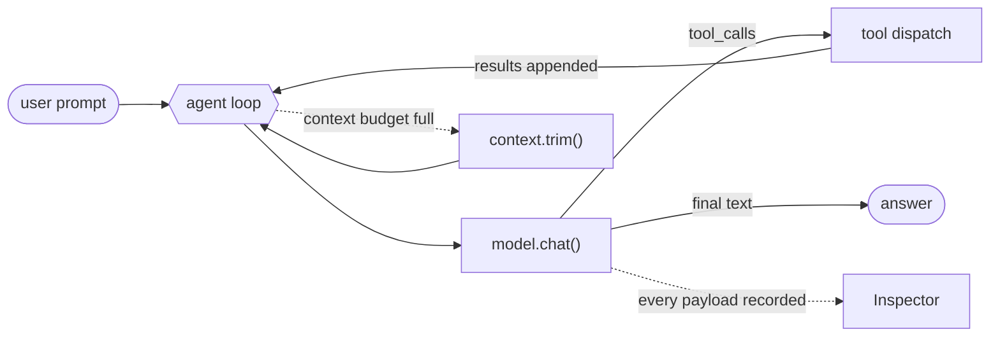
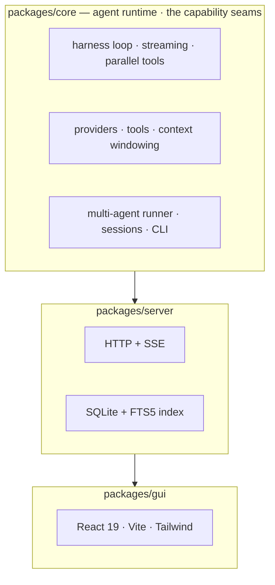
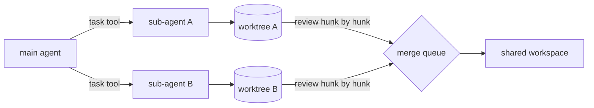

<h1 align="center">micro-harness</h1>

<p align="center">
  <a href="README.md"></a>
  <a href="README.zh-CN.md"></a>
</p>

<p align="center"><strong>A coding-agent platform built on compile-time seams — its own agent loop, multi-agent orchestration, an HTTP/SSE server, a CLI and a web GUI.</strong></p>

<p align="center">
  
  
  
  <a href="https://alexzhangupupup.github.io/micro-harness/"></a>
  
  
  
  
</p>

> 🌱 The original **minimal seed** — six source files, zero dependencies, no build step, run directly by Node ≥ 22.18 — is frozen at the [`seed-v1`](https://github.com/AlexZhangUPUPUP/micro-harness/tree/seed-v1) tag. Read that one end to end to understand the core; this branch is the platform grown from it.

---

## 📑 Table of Contents

- [✨ What is this](#-what-is-this)
- [📸 Preview](#-preview)
- [🚀 Quick start](#-quick-start)
- [🆚 How it differs from other harnesses](#-how-it-differs-from-other-harnesses)
- [🧩 How it is built](#-how-it-is-built)
- [🤖 Multi-agent](#-multi-agent)
- [🔌 MCP](#-mcp)
- [🧩 ACP: editors drive us](#-acp-editors-drive-us)
- [🖥️ The GUI](#-the-gui)
- [📐 Design principles](#-design-principles)
- [📁 Repository layout](#-repository-layout)
- [🗺️ Roadmap](#-roadmap)
- [🧪 Development](#-development)
- [🙌 Contributing](#-contributing)
- [📄 License](#-license)

---

## ✨ What is this

An **agent harness** is the runtime that turns an LLM into an agent: it runs the loop, executes tools, manages the context window and talks to the model. Most of the behaviour people attribute to "the model" actually lives here.

This repository is one, grown into a platform:



| | |
|---|---|
| **Events are the single contract** | The loop emits one tagged event stream. The session log, the server's SSE, the CLI, the trace panel, replay, the agent tree and the Inspector are all just consumers — no side channels. |
| **Seams, not a container** | The extension points are interfaces you compile against — `Provider`, `Tool`, `FileSystem`, `AgentRole`, `AgentEvent` — and composition is explicit code (`createServer`, `makeTools`). We built a DI container first, measured it (**0** runtime consumers across **25** assembly sites) and [deleted it](docs/design-comparison.md). |
| **Multi-agent is first-class** | A `task` tool with `single`/`parallel`/`chain`/`race` modes, real context isolation, and depth/concurrency/token/cost limits. |
| **Isolation with a review step** | Each sub-agent gets its own git worktree, so parallel agents can't overwrite each other — and you apply the result **hunk by hunk**. |
| **Observable by default** | Rolling token/cost, an agent tree, a replay scrubber, and an Inspector that shows the exact payload sent to the model. |

---

## 📸 Preview

**💬 Chat** — streaming Markdown with copy buttons, live token/cost, day-grouped sessions, and English / 简体中文 switched in place.

| | |
|---|---|
|  |  |

**🤝 Isolation & hunk-level review** — with `MICRO_ISOLATE=1` every sub-agent gets its own git worktree, and a returned diff is applied hunk by hunk; a hunk whose context has drifted is reported, never mis-applied.

| | |
|---|---|
|  |  |

**🔍 Trace, replay & Inspector** — the raw event stream with a replay scrubber that rebuilds the conversation from any slice, plus the exact system prompt, tool schemas and messages sent on each turn.

| | |
|---|---|
|  |  |

---

## 🚀 Quick start

**Requirements:** [Bun](https://bun.sh) ≥ 1.1 (the platform), or just Node ≥ 22.18 (the [`seed-v1`](https://github.com/AlexZhangUPUPUP/micro-harness/tree/seed-v1) tag). Any OpenAI-compatible endpoint works.

```bash
git clone https://github.com/AlexZhangUPUPUP/micro-harness.git
cd micro-harness
bun install

export MICRO_BASE_URL=https://api.deepseek.com   # any OpenAI-compatible endpoint
export MICRO_API_KEY=sk-...
export MICRO_MODEL=deepseek-chat                 # the provider's real model id
```

**Run the agent** (the CLI lives at `packages/core/src/cli.ts`):

```bash
bun start "Create hello.txt with 'hi', then read it back and print the contents"
bun start --allow-bash "Find the 3 largest files and summarise them"
bun start --isolate --tree "…"   # a git worktree per sub-agent, then print the agent tree
bun start                        # interactive REPL: /help, prompt templates, skills
```

**Install the binary** (one command, no publish required):

```bash
./scripts/install.sh                 # → ~/.local/bin/micro-harness
micro-harness --version              # 0.1.0
```

**Run the whole stack** — server, GUI and a key picked up automatically:

```bash
bun run ui                       # one process: the server serves the GUI  → http://127.0.0.1:8787
bun run dev                      # two processes (server + Vite preview)    → http://127.0.0.1:5273
```

Both open a browser (`scripts/dev.sh --no-open` to skip it); `MICRO_ISOLATE=1` gives every sub-agent its own git worktree.

Run either from **any folder**: the agent works in the folder you launch from, a free port is picked automatically (several terminals can each run their own), and closing the terminal stops everything. `microh` is the same thing from anywhere (installed by `scripts/install.sh`).

<details>
<summary>All CLI flags and environment variables</summary>

| flag | meaning |
|---|---|
| `--dir <path>` | working directory the tools are sandboxed to (default `.`) |
| `--model <id>` / `--base-url <url>` | override the environment config |
| `--approval <mode>` | `suggest` / `auto-edit` / `full-auto` (default) |
| `--allow-bash` | enable the `bash` tool (off by default) |
| `--isolate` | give every sub-agent its own git worktree |
| `--tree` | print the agent tree when the run finishes |
| `--max-steps <n>` / `--max-context <n>` | loop iterations (24) / context budget (24000) |
| `--trace` | append every event to a JSONL transcript |
| `--quiet` | don't print tool activity |

| variable | meaning |
|---|---|
| `MICRO_MODEL` / `MICRO_BASE_URL` / `MICRO_API_KEY` | model provider |
| `MICRO_MODELS` | comma-separated ids advertised by `GET /api/models` (the GUI model picker) |
| `MICRO_DATA_DIR` | session + index directory (default `~/.micro-harness`) |
| `MICRO_ISOLATE` | `1` → each sub-agent gets a git worktree |
| `MICRO_APPROVAL` | `full-auto` (default) / `auto-edit` / `suggest` — anything but `full-auto` asks through the GUI or the ACP client |
| `MICRO_PORT` / `MICRO_HOST` / `MICRO_SERVER_TOKEN` | server bind + auth |
| `MICRO_PRICE_INPUT` / `MICRO_PRICE_OUTPUT` | USD per 1M tokens, for cost tracking |
| `MICRO_ALLOW_BASH` | `1` → enable `bash` on the server too |

`dev.sh` prints which key it picked up — `key sk-41cdf912… (from ~/.pi/agent/auth.json)` — and warns when an exported key silently shadows a different one in `auth.json`, which otherwise shows up much later as a confusing `402 Insufficient Balance`.

</details>

---

## 🆚 How it differs from other harnesses

A design comparison, with sources: what we took from **DeepSeek Harness**, **pi**,
**Claude Code** and **Codex**, what we chose not to take, and where we are still unsure.
It is also where the deleted DI container lives, with the measurements behind it.

**→ [docs/design-comparison.md](docs/design-comparison.md)**

---

## 🧩 How it is built

Three packages, one direction of dependency. The core knows nothing about HTTP; the GUI only reads the event stream.



| package | what it is |
|---|---|
| `packages/core` | The seed, grown up: the loop, tool dispatch, context windowing, providers, the multi-agent runner, sessions, and the CLI. |
| `packages/server` | Bun HTTP + SSE. Sessions, streaming, the FTS5 search index, worktree isolation endpoints and the merge queue. |
| `packages/gui` | React 19 + Vite + Tailwind. Every view is derived from the event stream by pure, unit-tested functions in `lib/derive.ts`. |

---

## 🤖 Multi-agent

Sub-agents are isolated on purpose: a sub-agent starts with a fresh context, receives only the prompt you give it, and returns only its final answer. The parent never inherits its noise.



| mode | behaviour |
|---|---|
| `single` | one sub-agent |
| `parallel` | many at once, results joined |
| `chain` | sequential, `{previous}` interpolates the last result |
| `race` | many at once, first successful result wins |

Limits are enforced by the runner, not by convention: `--max-depth`, `--max-concurrency`, `--agent-timeout`, `--agent-max-tokens`, `--agent-max-cost`.

---

## 🔌 MCP

MCP servers are **read from config at boot** and their tools merged into the registry.
That is the whole integration: no container, no lifecycle manager, and nothing in the
loop, the event contract or the GUI knows MCP exists — an MCP tool is just a `Tool`.

```json
// .micro-harness/mcp.json  (or .mcp.json, or ~/.micro-harness/mcp.json, or $MICRO_MCP_CONFIG)
{
  "mcpServers": {
    "everything": { "command": "npx", "args": ["-y", "@modelcontextprotocol/server-everything"] },
    "remote":     { "url": "https://example.com/mcp", "headers": { "Authorization": "Bearer …" } }
  }
}
```

Both transports are implemented without the official SDK — **stdio** (spawn a child,
newline-delimited JSON-RPC) and **streamable HTTP** (JSON or a one-shot SSE reply) —
and tools are namespaced `<server>__<tool>` so two servers can both expose `search`.
`GET /api/mcp` reports what connected, and a server that fails to start is reported and
skipped rather than taking the session down.

Verified against the official reference server, end to end: 13 tools discovered, the
model was offered all of them alongside the built-in five, it called
`everything__get-sum {a:17,b:25}`, and answered `42`.

**First-party web tools.** `MICRO_WEB=off|fetch|search|all` (default `all`) connects a bundled MCP server exposing `web_search` and `web_fetch` — no config file needed. Search defaults to `bing` (no key, reachable where the global engines are blocked); `MICRO_SEARCH_PROVIDER` switches to `baidu`, `bocha` (博查, needs `BOCHA_API_KEY`) or `searxng` (`MICRO_SEARXNG_URL`). `web_fetch` is SSRF-guarded: it refuses non-public addresses and pins the validated IP for the connection.

Web is a permission capability: `read-only` and `workspace` never get these tools, `full` uses them freely, and `auto-review` asks before every call. A runtime switch at `~/.micro-harness/web.json` (the 🌐 button in the GUI) turns them off live — the server re-reads it per call, so no restart.

**What it deliberately does not do:** hot-plug a server into a running process, or
withdraw its tools when it drops. If that ever becomes a requirement, it is the trigger
we wrote down for bringing back the plugin container — see
[the comparison](docs/design-comparison.md).

---

## 🧩 ACP: editors drive us

The mirror image of MCP: `micro-harness acp` speaks the **Agent Client Protocol** on
stdio, so an editor (Zed, or anything with an ACP client) can drive this harness
directly. Protocol version 1; JSON-RPC, newline-delimited.

| direction | methods |
|---|---|
| **in** (client → agent) | `initialize` · `session/new` · `session/prompt` · `session/cancel` |
| **out** (agent → client) | `session/update` (streamed text, tool calls with `kind`/`status`, usage + cost) · `session/request_permission` · `fs/read_text_file` / `fs/write_text_file` |

Two things fall out of the design rather than being bolted on:

- **Approvals finally have a UI.** `--approval suggest` routes each mutating tool call to
  the editor through `session/request_permission`, so *allow once / always allow / reject
  / always reject* are real choices instead of a missing confirm hook.
- **The filesystem seam earns its keep.** When the client advertises `fs.readTextFile` /
  `fs.writeTextFile`, reads and writes go **through the editor** — so the agent sees
  unsaved buffers — while `list` stays on local disk, because ACP has no
  directory-listing primitive. That asymmetry is exactly why `FileSystem` is a provider
  *object* and not a boolean flag.

Verified by driving the real CLI as a subprocess with a real model: one turn produced 101
`session/update` notifications (streamed text, four tool calls, usage with cost), and
with the fs capability withheld the file really landed on disk (`hello from acp`).

**Driving it from Zed.** `scripts/acp.sh` starts the server with the model key resolved (from `~/.micro-harness/env`, then `~/.pi/agent/auth.json`), so no secret has to go into editor settings. Add it as a custom agent in Zed:

```json
{
  "agent_servers": {
    "micro-harness": {
      "type": "custom",
      "command": "/path/to/micro-harness/scripts/acp.sh",
      "args": []
    }
  }
}
```

Then open the Agent Panel and start a thread with `micro-harness`.

---

## 🖥️ The GUI

| area | what it does |
|---|---|
| **Sessions** | grouped Today / Yesterday / Earlier, inline rename, two-step delete, live status dots |
| **Transcript** | streaming Markdown + highlighted code with copy buttons; hover a user message to **edit & resend** (forks the session to that point, runs the edit, leaves the original untouched) |
| **Agents** | the sub-agent tree with connectors, per-node tokens/cost/hover card, worktree badges, and a prompt-cache hit chip (`⚡ cache 2.6k (78%)`) |
| **Trace** | the raw event stream with category chips, a text filter and a replay scrubber (REPLAY mode desaturates the view) |
| **Changes** | per-agent diff, **hunk-level accept/reject**, promote, and an integrate-all merge queue |
| **Inspector** | the exact payload of every model call: system prompt, tool schemas, messages, token estimate |
| **Palette** | `⌘K` — app actions plus full-text search across every saved session |
| **Attachments** | paste, drop or click-upload files into the composer: images travel as multimodal content parts, text files ride along with the prompt |
| **Web** | 🌐 toggles live web access (`web_search` / `web_fetch` via the bundled MCP server) |
| **Permissions** | four presets — read-only / workspace / full / auto-review — with a confirmation before granting shell access; `--approval` still controls per-call prompts |
| **Approvals** | when the server runs `--approval suggest`/`auto-edit`, a mutating tool call blocks and the transcript shows an Allow / Deny card |
| **Session tree** | flip the sidebar to tree mode to see forks nested under their origin |
| **Composer** | model picker fed by `/api/models`, desktop notification when a run finishes in a background tab |

| key | action |
|---|---|
| `⌘K` / `Ctrl K` | command palette |
| `⌘/` | keyboard cheat sheet |
| `↑` `↓` | move through the sidebar or the palette |
| `Enter` / `⇧ Enter` | send / newline |
| `Esc` | close any dialog |

---

## 📐 Design principles

- **The seed is dependency-free; the platform is not.** `seed-v1` uses only Node built-ins. This branch is a Bun monorepo — Bun for the toolchain, `bun:sqlite` for the index, React + Vite + Tailwind for the GUI — though the root `package.json` still declares no runtime dependencies.
- **Errors are data.** A failed tool returns `{ output, isError: true }` and is appended as a normal `tool` message, so the model sees the failure and can recover. That is what makes a loop robust.
- **Compaction is a strategy, not a constant.** The default drops the middle deterministically; `--compact=summarize` replaces the dropped turns with one model-written recap (and falls back to dropping if that call fails). `--max-cost` stops a run before it can spend without limit.
- **Measured, with an ablation.** One real session (DeepSeek, 31 model calls) designed so
the stimulus cannot be dodged: turn 1 plants an unguessable rule that exists nowhere on
disk (`every file must end with // PROJECT-CHECK-7Q4`), then six turns dump ~8 KB of tool
output each into a deliberately small window (5000 tokens), and a final turn asks for a
file that must obey the rule. Grading is binary — the marker is either in the file or it
is not:

| policy | rule survived | trims | dropped | peak after trim | cache hit | cost |
|---|---|---|---|---|---|---|
| **`drop-middle`** (default) | **yes** | 4 | 16 | 4455 / 5000 | 66% | $0.00596 |
| `tail` (ablation, head not kept) | **no** | 4 | 18 | 4402 / 5000 | 66% | $0.00584 |
| `summarize` | yes | 4 | 15 | 4762 / 5000 | 64% | $0.00576 |

The ablation is the point: the same session with the head *not* kept loses the rule, so
the pass is caused by the mechanism and not by luck. Two honest caveats fell out of it —
the window held (0 API errors) but **cache hits decay to ~66% under repeated compaction**
because each trim churns the prefix, and `summarize` preserves the rule at roughly the
same cost but leaves a higher peak (the recap itself occupies tokens).
- **The budget holds even inside one long turn.** Compaction normally drops whole *turns*, but a coding run is often a single user message followed by dozens of tool calls — there is no older turn to drop. Measured on a real 24-turn audit: before this was handled the context peaked at **52,700 tokens against a 24,000 budget** with **zero** compactions; the fallback now drops *steps* (an assistant message plus the tool results it produced, never separated) and the same run peaks at **23,685 / 24,000** with 7 compactions.
- **Never rewrite the past.** A tool result is capped *when it is appended*, not when the window later fills, so the message prefix stays byte-stable — which is exactly what lets a provider's prompt cache hit. When the window does fill, compaction drops the **middle**: it keeps the system prompt and the first user turn (where the constraints live) plus the newest turns, so a `tool` message is never orphaned from its call and early instructions survive.
- **Measure the economics.** Providers report prompt-cache hits under three different names; they are normalized into `usage.cacheRead`, priced at the cached rate (a cache hit is ~10x cheaper than a miss on DeepSeek), and surfaced in the GUI as a hit rate — a real run on this repo hits 69–78%.
- **Sandboxing.** File tools resolve every path inside `--dir` and refuse traversal; `bash` is opt-in.
- **Share capabilities, isolate state.** Providers, tools and the store are shared; messages, cwd and policy are per session and per sub-agent.
- **Small, testable pure functions.** Diff parsing, hunk selection, transcript derivation, session grouping and the usage series are pure and unit-tested — the UI just renders them.

---

## 📁 Repository layout

```
micro-harness/
├── packages/
│   ├── core/                    # agent loop, tools, context, providers, multi-agent, CLI
│   ├── server/                  # HTTP + SSE + SQLite/FTS5 index
│   └── gui/                     # React 19 + Vite + Tailwind web UI
├── scripts/
│   ├── dev.sh                   # one command: server + GUI + key resolution
│   ├── verify-features.ts       # scripted end-to-end feature checks (no network)
│   └── auto-run.sh              # unattended driver
├── docs/                        # screenshots + design notes
├── ARCHITECTURE.md              # design baseline (zh)
├── ROADMAP.md                   # P0–P10 plan (zh)
└── PROGRESS.md                  # build log
```

---

## 🗺️ Roadmap

- [x] **P0 · Foundation** — monorepo, Bun toolchain, CI
- [x] ~~**P1 · Kernel** — services/DI, lifecycle, scopes, event bus~~ **reverted**: built (396 lines, 10 tests), measured as having 0 runtime consumers, and removed in favour of compile-time seams. See [the comparison](docs/design-comparison.md).
- [x] **P2 · Event-driven core** — `AgentEvent`, streaming, parallel tool calls, approval modes, sessions
- [x] **P3 · Multi-agent** — runner, `task` tool, context firewall, limits
- [x] **P4 · Server** — HTTP + SSE, session API, SQLite/FTS5 index
- [x] **P5 · CLI** — one-shot, REPL, slash commands, prompt templates, skills
- [x] **P6 · GUI** — sessions, transcript, agent tree, trace + replay, changes
- [x] **P7 · Isolation** — git worktrees per agent, promote, merge queue
- [x] **P8 · Interop** — MCP client, ACP server
- [x] **P9 · Context economics** — compaction strategies, cache-prefix reuse, cost metering
- [x] **P10 · Evaluation & release** — eval suite (26 tasks, golden set + judge calibration), `bun build --compile`, `scripts/install.sh`; docs site pending, npm publish skipped by choice

---

## 🧪 Development

```bash
bun install
bun test              # 155 tests across 21 files
bun run typecheck     # tsc --noEmit, clean
bun run verify        # scripted feature checks (no network)
bun run eval:mock      # eval suite against a scripted provider — CI-safe, no network
bun run eval --judge   # the same suite plus an LLM judge for open-ended tasks
```

The suite covers the event loop and its streaming, parallel tool calls and approvals, session replay, multi-agent limits and the context firewall, MCP and ACP, the server's endpoints and its JSONL/SQLite store, worktree isolation and the merge queue, part-level patch application against real `git diff` output, and every pure derivation the GUI renders.

---

## 🙌 Contributing

Issues and pull requests are welcome. If you are looking for a place to start, the roadmap's remaining item (**P10 · Documentation site**; npm publish is skipped by choice) and anything marked *good first issue* are good entry points.

Two things that make a PR easy to accept:

1. `bun test` and `bun run typecheck` pass.
2. New behaviour comes with the test that would have caught it — the pure functions in `packages/core/src` and `packages/gui/src/lib/derive.ts` are where most logic lives, and they are cheap to test.

---

## 📄 License

[MIT](LICENSE).

The seed at the `seed-v1` tag grew out of [PiStudio](https://github.com/AlexZhangUPUPUP/PiStudio); the worktree and merge-queue ports in `packages/core/src` still carry that lineage.

