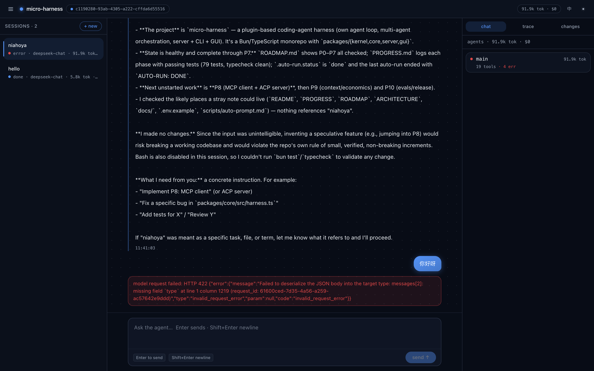
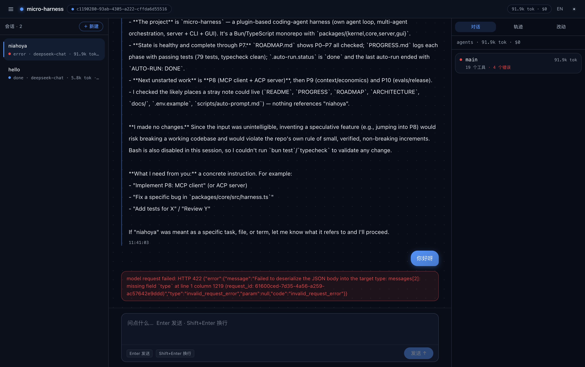
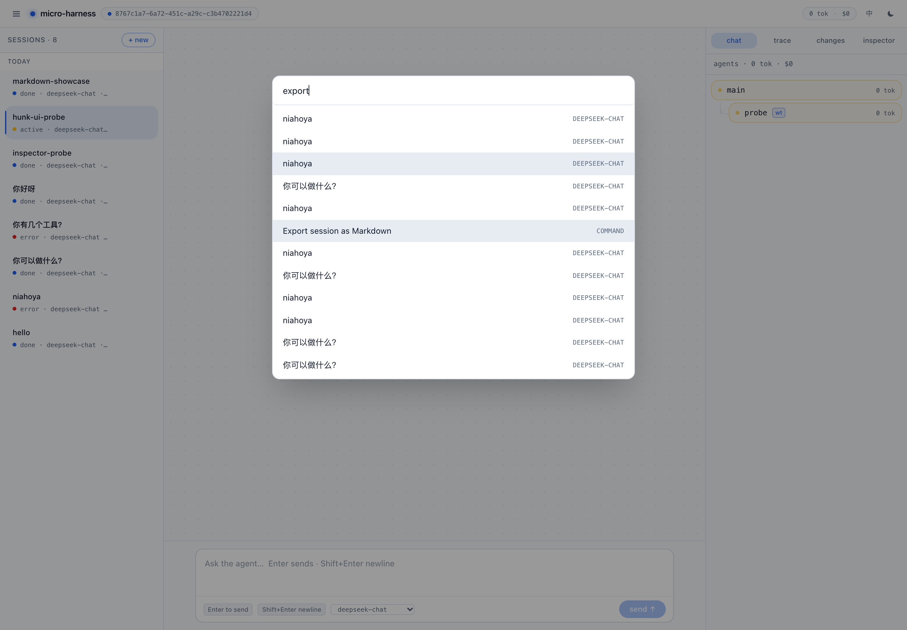
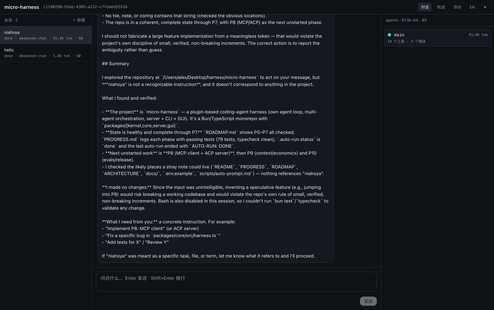
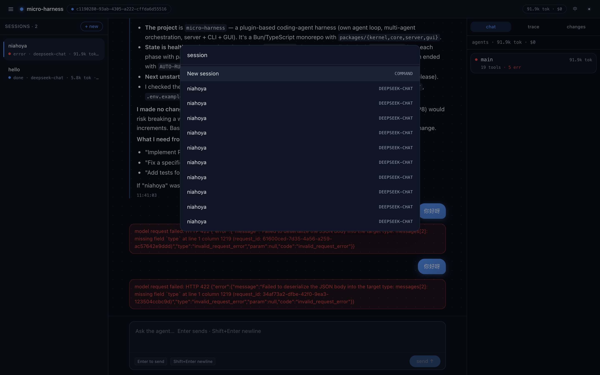
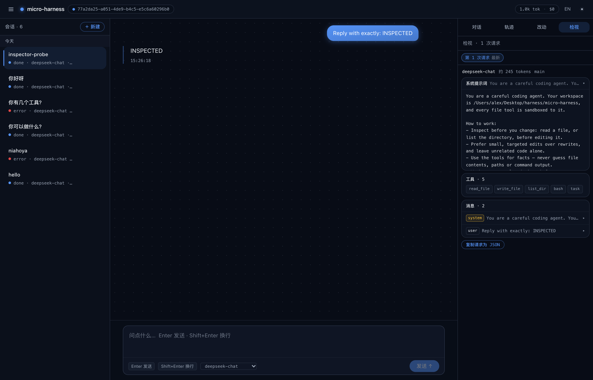
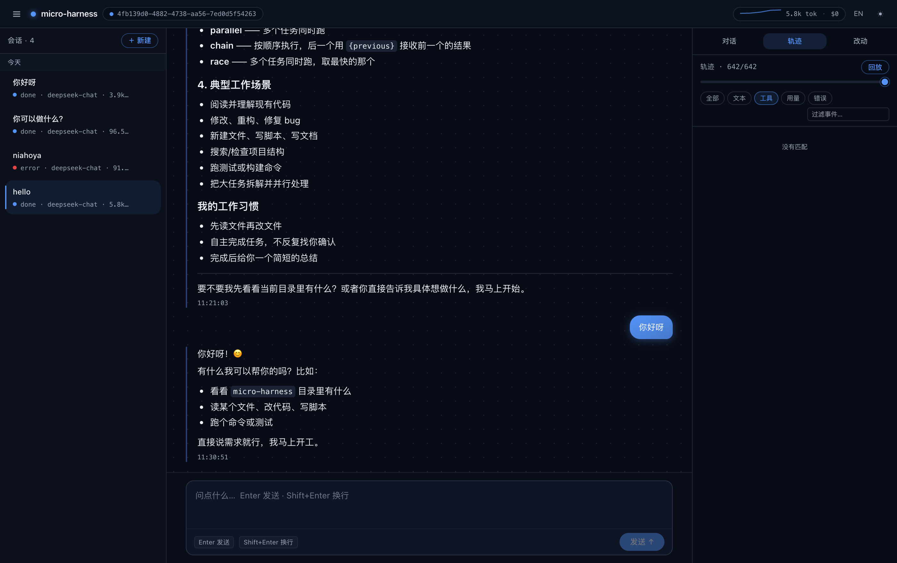

# micro-harness

**A plugin-based coding-agent platform** — its own agent loop, multi-agent
orchestration, server, CLI and web GUI — grown from a minimal, readable harness.

**English** · [简体中文](README.zh-CN.md)

> **Where is the minimal seed?** The original seed — six files under `src/`, no
dependencies, no build step, run directly by Node ≥ 22.18 — is frozen at the
[`seed-v1`](https://github.com/AlexZhangUPUPUP/micro-harness/tree/seed-v1) tag. Read
that one end to end to understand how an agent harness works; this branch is the
platform built on the same design. The platform's P0 moved the seed into
`packages/core`, which is why there is no `src/` here.

> An **agent harness** is the runtime that wraps an LLM and turns it into an
> agent: it runs the loop, executes tools, manages the context window and talks to
> the model.

```
        ┌──────────────────────────────────────────────────────┐
        │                      harness                         │
        │                                                      │
 user ──┼──▶ messages ──▶ model.chat() ──▶ tool_calls? ──┐     │
        │                     ▲                          │     │
        │                     │                          ▼     │
        │              append tool result ◀── tool dispatch ───┼──▶ read_file / write_file / list_dir / bash
        │                     │                                │
        │              context.trim() when the window fills    │
        └──────────────────────────────────────────────────────┘
```

## Run it

```bash
bun install

# the CLI — the seed's cli.ts, grown up, now at packages/core/src/cli.ts
bun start "Create hello.txt with 'hi', then read it back and print the contents"
bun start                       # interactive REPL (/help, prompt templates, skills)
bun start --allow-bash "Find the 3 largest files and summarise them"
bun start --isolate --tree "…"  # a git worktree per sub-agent + print the agent tree
bun start -- run --auto --tasks tasks.txt   # unattended driver (budget + timeout)

# the whole stack: server (SSE + SQLite/FTS) and the GUI
scripts/dev.sh                  # → http://127.0.0.1:5273
```

| flag | meaning |
|---|---|
| `--dir <path>` | working directory the tools are sandboxed to (default `.`) |
| `--model <id>` / `--base-url <url>` | override the env config |
| `--approval <mode>` | `suggest` / `auto-edit` / `full-auto` (default `full-auto`) |
| `--allow-bash` | enable the `bash` tool (off by default) |
| `--isolate` | give every sub-agent its own git worktree |
| `--tree` | print the agent tree when the run finishes |
| `--max-steps <n>` / `--max-context <n>` | loop iterations (24) / context budget (24000) |
| `--trace` | append every event to a JSONL transcript |
| `--quiet` | don't print tool activity |

## The four pieces

Still the heart of the project — the seed's four files now live in
`packages/core/src/`, and everything else is built around them:

| file | what it is |
|---|---|
| `packages/core/src/harness.ts` | **the loop** — model → tools → feed results back → repeat, with a step limit, parallel tool calls and approval modes |
| `packages/core/src/tools.ts` | **tool registry + dispatch** — `read_file`, `write_file`, `list_dir`, `bash`; path-sandboxed; tool errors become messages the model can recover from |
| `packages/core/src/context.ts` | **context windowing** — token estimate + trimming that keeps the system prompt and whole turns, never orphaning a tool result from its call |
| `packages/core/src/model.ts` | **model I/O** — an OpenAI-compatible `chat/completions` call with streaming and retries on 429/5xx |

## Design notes

- **The seed is dependency-free; the platform is not.** `main`'s `src/` uses only
  Node built-ins. This branch is a Bun monorepo — Bun for the toolchain,
  `bun:sqlite` for the index, React + Vite + Tailwind for the GUI — though the root
  `package.json` still declares no runtime dependencies.
- **Errors are data.** A failed tool returns `{ output, isError: true }` which is
  appended as a normal `tool` message — the model sees the failure and can retry,
  which is what makes an agent loop robust.
- **Sandboxing.** File tools resolve every path inside `--dir` and refuse
  traversal; `bash` is opt-in.
- **Trimming keeps turns intact.** A `tool` message is only ever kept together
  with the assistant `tool_calls` that produced it.
- **Events are the single contract.** The loop emits one tagged event stream; the
  session JSONL, the server's SSE, the CLI, the GUI's trace/replay and the
  Inspector are all just consumers of it.
- **Share capabilities, isolate state.** Providers, tools and the store are
  shared; messages, cwd and policy are per session and per sub-agent.

## Tests

```bash
bun install
bun test          # unit suite: kernel, core, server, gui derivation
bun run verify    # P3/P4/P5 feature checks (scripted provider, no network)
bun run typecheck
```

## Packages

- `packages/kernel` — plugin kernel: services/DI, lifecycle, scopes, events
- `packages/core` — agent loop, tools, context, providers, multi-agent, sessions, CLI
- `packages/server` — HTTP + SSE + SQLite/FTS index
- `packages/gui` — React web UI

## GUI

A React 19 + Vite + Tailwind front end (design tokens shared with PiStudio): a
session list, a streaming transcript with tool cards, a **multi-agent tree** with
per-agent tokens/cost, a **trace panel with a replay scrubber** that rebuilds the
conversation from a slice of the event stream, and a **changes panel** (per-agent
diff / promote + an integrate-all **merge queue**) when the server runs with
`MICRO_ISOLATE=1`.



With isolation on, each sub-agent gets its own git worktree, so parallel agents
never overwrite each other:



Because an agent's output is a diff, the changes panel lets you review it **hunk by
hunk** and apply exactly the parts you want (`packages/core/src/patch.ts` parses the
diff and replays only the accepted hunks; `POST …/agents/:id/apply` writes them
through the same integrate/apply path, so backups and conflict reporting come for
free). A hunk whose context has already drifted is reported, never mis-applied:



The UI is bilingual — **English / 简体中文** — switched in place with the `中 / EN`
button (it follows the browser language on first visit):



```bash
# one command — starts the server and the GUI, and picks up an API key
scripts/dev.sh                 # → http://127.0.0.1:5273

# or run the two halves yourself:
MICRO_API_KEY=… bun packages/server/src/main.ts          # terminal 1
cd packages/gui && MICRO_SERVER=http://127.0.0.1:8787 bun run dev   # terminal 2
```

The server reads `MICRO_MODEL` (use the provider's real model id, e.g.
`deepseek-chat`), `MICRO_BASE_URL`, `MICRO_API_KEY`, `MICRO_DATA_DIR` and
`MICRO_MODELS`. `dev.sh` prints which key it picked up — `key sk-41cdf912… (from
~/.pi/agent/auth.json)` — and warns when an exported key silently shadows a different
one in `auth.json`, which is otherwise a confusing "why is my balance zero" 402.

The transcript renders **Markdown with syntax-highlighted code** (a dependency-free
renderer ported from PiStudio), and **⌘K** opens a command palette that also does
full-text search across every saved session (`/api/search`, FTS5):



The right panel has four views. **agents** draws the sub-agent tree with per-node
usage (hover a node for its detail card); **trace** is the raw event stream with
category chips, a text filter and a replay scrubber; **changes** reviews an agent's
diff hunk by hunk; and **inspector** answers *"what exactly did we send to the
model?"* — for every turn it shows the exact payload that went out: the system
prompt, the tool schemas, and every message, taken straight from a `model.request`
event:





Everything the GUI renders is derived from the event stream by pure functions in
`packages/gui/src/lib/derive.ts` (unit-tested).

The details that make it feel like a real coding tool: live usage is a **rolling
number next to an inline sparkline** of tokens per model call; the agent tree draws
real connectors and shows a detail card on hover; the changes panel renders a
**colored diff with an old/new line-number gutter**; sessions are grouped into
**Today / Yesterday / Earlier** with hover-to-delete; the transcript only auto-follows
while you are parked at the bottom (scroll up and it freezes, surfacing a "back to
bottom" pill); and scrubbing the trace desaturates the whole view into **REPLAY** mode.

### Keyboard

| key | action |
|---|---|
| `⌘K` / `Ctrl K` | command palette — app actions + full-text session search |
| `⌘/` | keyboard cheat sheet |
| `↑` `↓` | move through the sidebar or the palette |
| `Enter` | send the prompt |
| `⇧ Enter` | newline in the prompt |
| `Esc` | close any dialog |

The palette also exports the current session as Markdown and copies the raw trace as
JSON. A desktop notification fires when a run finishes while the tab is hidden.

Sessions can be **renamed inline** (hover a row) or deleted, and the transcript is
editable: hovering a user message offers **edit & resend**, which forks the session
truncated to just before that message and runs the edited prompt in the fork — the
original session is left untouched. The composer's **model picker** is fed by
`GET /api/models`, so `MICRO_MODELS=model-a,model-b scripts/dev.sh` advertises
several.

## The seed is a frozen tag

| ref | what it is |
|---|---|
| [`seed-v1`](https://github.com/AlexZhangUPUPUP/micro-harness/tree/seed-v1) | the **minimal seed** — `src/`, six files, zero dependencies, no build step, run by Node ≥ 22.18. Frozen: the reference implementation to read end to end, and it does not move. |
| `main` (this branch) | the **platform** — `packages/{kernel,core,server,gui}`: plugin kernel, event-driven core, multi-agent orchestration, server, CLI and GUI, built on the seed's design. |

The seed was not duplicated — P0 *moved* those files into `packages/core` and grew
the platform around them. Keeping the original as a tag instead of a second branch
means there is exactly one line of development (no README to maintain twice, no two
copies of the same file drifting apart) while the readable original stays browsable
and immutable.

See **[ARCHITECTURE.md](ARCHITECTURE.md)** for the design of the full harness
platform — plugin kernel, composition, server, GUI, MCP/ACP — and
**[ROADMAP.md](ROADMAP.md)** for the long-term plan.

## License

MIT
