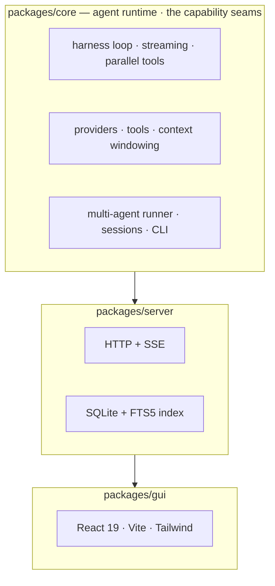
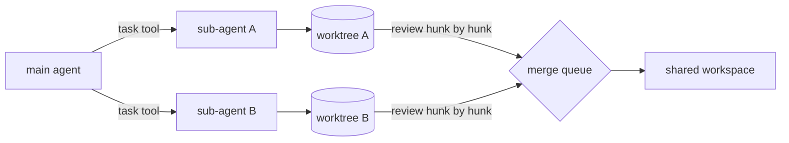

<h1 align="center">micro-harness</h1>

<p align="center">
  <a href="README.md"></a>
  <a href="README.zh-CN.md"></a>
</p>

<p align="center"><strong>A plugin-based coding-agent platform — its own agent loop, multi-agent orchestration, an HTTP/SSE server, a CLI and a web GUI.</strong></p>

<p align="center">
  
  
  
  
  
  
  
</p>

> 🌱 The original **minimal seed** — six files, zero dependencies, no build step, run directly by Node ≥ 22.18 — is frozen at the [`seed-v1`](https://github.com/AlexZhangUPUPUP/micro-harness/tree/seed-v1) tag. Read that one end to end to understand the core; this branch is the platform grown from it.

---

## 📑 Table of Contents

- [✨ What is this](#-what-is-this)
- [🆚 How it differs from other harnesses](#-how-it-differs-from-other-harnesses)
- [📸 Preview](#-preview)
- [🚀 Quick start](#-quick-start)
- [🧩 How it is built](#-how-it-is-built)
- [🤖 Multi-agent](#-multi-agent)
- [🔌 MCP](#-mcp)
- [🖥 The GUI](#-the-gui)
- [📐 Design principles](#-design-principles)
- [📁 Repository layout](#-repository-layout)
- [🗺 Roadmap](#-roadmap)
- [🧪 Development](#-development)
- [🤝 Contributing](#-contributing)
- [📄 License](#-license)

---

## ✨ What is this

An **agent harness** is the runtime that turns an LLM into an agent: it runs the loop, executes tools, manages the context window and talks to the model. Most of the behaviour people attribute to "the model" actually lives here.

This repository is one, grown into a platform — and it stays readable while doing it:


| | |
|---|---|
| **Events are the single contract** | The loop emits one tagged event stream. The session log, the server's SSE, the CLI, the trace panel, replay, the agent tree and the Inspector are all just consumers — no side channels. |
| **Seams, not a container** | The extension points are interfaces you compile against — `Provider`, `Tool`, `FileSystem`, `AgentRole`, `AgentEvent` — and composition is explicit code (`createServer`, `makeTools`). We built a DI container first, measured it (**0** runtime consumers across **25** assembly sites) and [deleted it](docs/design-comparison.md). |
| **Multi-agent is first-class** | A `task` tool with `single`/`parallel`/`chain`/`race` modes, real context isolation, and depth/concurrency/token/cost limits. Not bolted on. |
| **Isolation with a review step** | Each sub-agent gets its own git worktree, so parallel agents can't overwrite each other — and you apply the result **hunk by hunk**. |
| **Observable by default** | Rolling token/cost, an agent tree, a replay scrubber, and an Inspector that shows the exact payload sent to the model. |

---

## 📸 Preview

### 💬 Chat — streaming, Markdown, live usage

> Assistant messages render as Markdown with syntax-highlighted code and a copy button. Live usage rolls up next to a sparkline, sessions are grouped by day, and `⌘K` opens a command palette that also full-text searches every saved session.


### 🌏 Bilingual

> English and 简体中文, switched in place with the `中 / EN` button (it follows the browser language on first visit).


### 🤝 Isolation and hunk-level review

> With `MICRO_ISOLATE=1` every sub-agent works in its own git worktree, so parallel agents never collide. When a diff comes back you review it hunk by hunk and apply exactly the parts you want; a hunk whose context has drifted is reported instead of silently mis-applied.


### 🔍 Trace, replay and the Inspector

> The raw event stream with category filters and a replay scrubber that rebuilds the conversation from any slice — and the Inspector, which shows the exact system prompt, tool schemas and messages that went out on each turn.


---

## 🚀 Quick start

**Requirements:** [Bun](https://bun.sh) ≥ 1.1 (the platform), or just Node ≥ 22.18 (the [`seed-v1`](https://github.com/AlexZhangUPUPUP/micro-harness/tree/seed-v1) tag). Any OpenAI-compatible endpoint works.

```bash
git clone https://github.com/AlexZhangUPUPUP/micro-harness.git
cd micro-harness
bun install

export MICRO_BASE_URL=https://api.deepseek.com   # any OpenAI-compatible endpoint
export MICRO_API_KEY=sk-...
export MICRO_MODEL=deepseek-chat                 # the provider's real model id
```

**Run the agent** (the CLI lives at `packages/core/src/cli.ts`):

```bash
bun start "Create hello.txt with 'hi', then read it back and print the contents"
bun start --allow-bash "Find the 3 largest files and summarise them"
bun start --isolate --tree "…"   # a git worktree per sub-agent, then print the agent tree
bun start                        # interactive REPL: /help, prompt templates, skills
```

**Run the whole stack** — server, GUI and a key picked up automatically:

```bash
scripts/dev.sh                   # → http://127.0.0.1:5273
```

<details>
<summary>All CLI flags and environment variables</summary>

| flag | meaning |
|---|---|
| `--dir <path>` | working directory the tools are sandboxed to (default `.`) |
| `--model <id>` / `--base-url <url>` | override the environment config |
| `--approval <mode>` | `suggest` / `auto-edit` / `full-auto` (default) |
| `--allow-bash` | enable the `bash` tool (off by default) |
| `--isolate` | give every sub-agent its own git worktree |
| `--tree` | print the agent tree when the run finishes |
| `--max-steps <n>` / `--max-context <n>` | loop iterations (24) / context budget (24000) |
| `--trace` | append every event to a JSONL transcript |
| `--quiet` | don't print tool activity |

| variable | meaning |
|---|---|
| `MICRO_MODEL` / `MICRO_BASE_URL` / `MICRO_API_KEY` | model provider |
| `MICRO_MODELS` | comma-separated ids advertised by `GET /api/models` (the GUI model picker) |
| `MICRO_DATA_DIR` | session + index directory (default `~/.micro-harness`) |
| `MICRO_ISOLATE` | `1` → each sub-agent gets a git worktree |
| `MICRO_PORT` / `MICRO_HOST` / `MICRO_SERVER_TOKEN` | server bind + auth |
| `MICRO_PRICE_INPUT` / `MICRO_PRICE_OUTPUT` | USD per 1M tokens, for cost tracking |
| `MICRO_ALLOW_BASH` | `1` → enable `bash` on the server too |

`dev.sh` prints which key it picked up — `key sk-41cdf912… (from ~/.pi/agent/auth.json)` — and warns when an exported key silently shadows a different one in `auth.json`, which otherwise shows up much later as a confusing `402 Insufficient Balance`.

</details>

---

## 🆚 How it differs from other harnesses

Every harness README implies "we are the good one". This one shows its work instead:
what we took from **DeepSeek Harness**, **pi**, **Claude Code** and **Codex**, what we
deliberately rejected, and where we are unsure. It is also where the deleted DI container
lives — with the measurements that justified removing it.

**→ [docs/design-comparison.md](docs/design-comparison.md)**

---

## 🧩 How it is built

Three packages, one direction of dependency. The core knows nothing about HTTP; the GUI only reads the event stream.



| package | what it is |
|---|---|
| `packages/core` | The seed, grown up: the loop, tool dispatch, context windowing, providers, the multi-agent runner, sessions, and the CLI. |
| `packages/server` | Bun HTTP + SSE. Sessions, streaming, the FTS5 search index, worktree isolation endpoints and the merge queue. |
| `packages/gui` | React 19 + Vite + Tailwind. Every view is derived from the event stream by pure, unit-tested functions in `lib/derive.ts`. |

---

## 🤖 Multi-agent

Sub-agents are isolated on purpose: a sub-agent starts with a fresh context, receives only the prompt you give it, and returns only its final answer. The parent never inherits its noise.



| mode | behaviour |
|---|---|
| `single` | one sub-agent |
| `parallel` | many at once, results joined |
| `chain` | sequential, `{previous}` interpolates the last result |
| `race` | many at once, first successful result wins |

Limits are enforced by the runner, not by convention: `--max-depth`, `--max-concurrency`, `--agent-timeout`, `--agent-max-tokens`, `--agent-max-cost`.

---

## 🔌 MCP

MCP servers are **read from config at boot** and their tools merged into the registry.
That is the whole integration: no container, no lifecycle manager, and nothing in the
loop, the event contract or the GUI knows MCP exists — an MCP tool is just a `Tool`.

```json
// .micro-harness/mcp.json  (or .mcp.json, or ~/.micro-harness/mcp.json, or $MICRO_MCP_CONFIG)
{
  "mcpServers": {
    "everything": { "command": "npx", "args": ["-y", "@modelcontextprotocol/server-everything"] },
    "remote":     { "url": "https://example.com/mcp", "headers": { "Authorization": "Bearer …" } }
  }
}
```

Both transports are implemented without the official SDK — **stdio** (spawn a child,
newline-delimited JSON-RPC) and **streamable HTTP** (JSON or a one-shot SSE reply) —
and tools are namespaced `<server>__<tool>` so two servers can both expose `search`.
`GET /api/mcp` reports what connected, and a server that fails to start is reported and
skipped rather than taking the session down.

Verified against the official reference server, end to end: 13 tools discovered, the
model was offered all of them alongside the built-in five, it called
`everything__get-sum {a:17,b:25}`, and answered `42`.

**What it deliberately does not do:** hot-plug a server into a running process, or
withdraw its tools when it drops. If that ever becomes a requirement, it is the trigger
we wrote down for bringing back the plugin container — see
[the comparison](docs/design-comparison.md).

---

## 🖥 The GUI

| area | what it does |
|---|---|
| **Sessions** | grouped Today / Yesterday / Earlier, inline rename, two-step delete, live status dots |
| **Transcript** | streaming Markdown + highlighted code with copy buttons; hover a user message to **edit & resend** (forks the session to that point, runs the edit, leaves the original untouched) |
| **Agents** | the sub-agent tree with connectors, per-node tokens/cost/hover card, worktree badges, and a prompt-cache hit chip (`⚡ cache 2.6k (78%)`) |
| **Trace** | the raw event stream with category chips, a text filter and a replay scrubber (REPLAY mode desaturates the view) |
| **Changes** | per-agent diff, **hunk-level accept/reject**, promote, and an integrate-all merge queue |
| **Inspector** | the exact payload of every model call: system prompt, tool schemas, messages, token estimate |
| **Palette** | `⌘K` — app actions plus full-text search across every saved session |
| **Composer** | model picker fed by `/api/models`, desktop notification when a run finishes in a background tab |

| key | action |
|---|---|
| `⌘K` / `Ctrl K` | command palette |
| `⌘/` | keyboard cheat sheet |
| `↑` `↓` | move through the sidebar or the palette |
| `Enter` / `⇧ Enter` | send / newline |
| `Esc` | close any dialog |

---

## 📐 Design principles

- **The seed is dependency-free; the platform is not.** `seed-v1` uses only Node built-ins. This branch is a Bun monorepo — Bun for the toolchain, `bun:sqlite` for the index, React + Vite + Tailwind for the GUI — though the root `package.json` still declares no runtime dependencies.
- **Errors are data.** A failed tool returns `{ output, isError: true }` and is appended as a normal `tool` message, so the model sees the failure and can recover. That is what makes a loop robust.
- **Never rewrite the past.** A tool result is capped *when it is appended*, not when the window later fills, so the message prefix stays byte-stable — which is exactly what lets a provider's prompt cache hit. When the window does fill, compaction drops the **middle**: it keeps the system prompt and the first user turn (where the constraints live) plus the newest turns, so a `tool` message is never orphaned from its call and early instructions survive.
- **Measure the economics.** Providers report prompt-cache hits under three different names; they are normalized into `usage.cacheRead`, priced at the cached rate (a cache hit is ~10x cheaper than a miss on DeepSeek), and surfaced in the GUI as a hit rate — a real run on this repo hits 69–78%.
- **Sandboxing.** File tools resolve every path inside `--dir` and refuse traversal; `bash` is opt-in.
- **Share capabilities, isolate state.** Providers, tools and the store are shared; messages, cwd and policy are per session and per sub-agent.
- **Small, testable pure functions.** Diff parsing, hunk selection, transcript derivation, session grouping and the usage series are pure and unit-tested — the UI just renders them.

---

## 📁 Repository layout

```
micro-harness/
├── packages/
│   ├── core/                    # agent loop, tools, context, providers, multi-agent, CLI
│   ├── server/                  # HTTP + SSE + SQLite/FTS5 index
│   └── gui/                     # React 19 + Vite + Tailwind web UI
├── scripts/
│   ├── dev.sh                   # one command: server + GUI + key resolution
│   ├── verify-features.ts       # scripted end-to-end feature checks (no network)
│   └── auto-run.sh              # unattended driver
├── docs/                        # screenshots used by this README
├── ARCHITECTURE.md              # design baseline (zh)
├── ROADMAP.md                   # P0–P10 plan (zh)
└── PROGRESS.md                  # build log
```

---

## 🗺 Roadmap

- [x] **P0 · Foundation** — monorepo, Bun toolchain, CI
- [x] ~~**P1 · Kernel** — services/DI, lifecycle, scopes, event bus~~ **reverted**: built (396 lines, 10 tests), measured as having 0 runtime consumers, and removed in favour of compile-time seams. See [the comparison](docs/design-comparison.md).
- [x] **P2 · Event-driven core** — `AgentEvent`, streaming, parallel tool calls, approval modes, sessions
- [x] **P3 · Multi-agent** — runner, `task` tool, context firewall, limits
- [x] **P4 · Server** — HTTP + SSE, session API, SQLite/FTS5 index
- [x] **P5 · CLI** — one-shot, REPL, slash commands, prompt templates, skills
- [x] **P6 · GUI** — sessions, transcript, agent tree, trace + replay, changes
- [x] **P7 · Isolation** — git worktrees per agent, promote, merge queue
- [ ] **P8 · Interop** — MCP client, ACP server
- [ ] **P9 · Context economics** — compaction strategies, cache-prefix reuse, cost metering
- [ ] **P10 · Evaluation & release** — eval suite, `bun build --compile`, publish

---

## 🧪 Development

```bash
bun install
bun test              # 120 tests across 19 files
bun run typecheck     # tsc --noEmit, clean
bun run verify        # scripted feature checks (no network)
```

The suite covers the kernel's lifecycle and scoping, the loop and its streaming, approvals, session replay, the server's endpoints, worktree isolation, partial patch application against real `git diff` output, and every pure derivation the GUI renders.

---

## 🤝 Contributing

Issues and pull requests are welcome. If you are looking for a place to start, the roadmap's unfinished phases (**P8–P10**) and anything marked *good first issue* are good entry points.

Two things that make a PR easy to accept:

1. `bun test` and `bun run typecheck` pass.
2. New behaviour comes with the test that would have caught it — the pure functions in `packages/core/src` and `packages/gui/src/lib/derive.ts` are where most logic lives, and they are cheap to test.

---

## 📄 License

[MIT](LICENSE).

The seed at the `seed-v1` tag grew out of [PiStudio](https://github.com/AlexZhangUPUPUP/PiStudio); the worktree and merge-queue ports in `packages/core/src` still carry that lineage.

---

## ⭐ Star history

<a href="https://star-history.com/#AlexZhangUPUPUP/micro-harness&Date">
  
</a>
