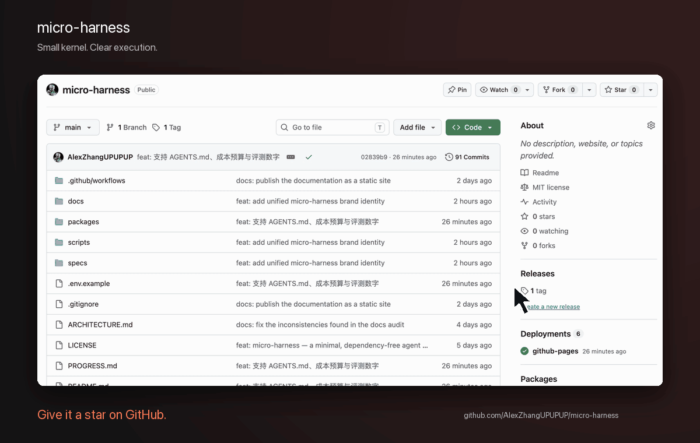
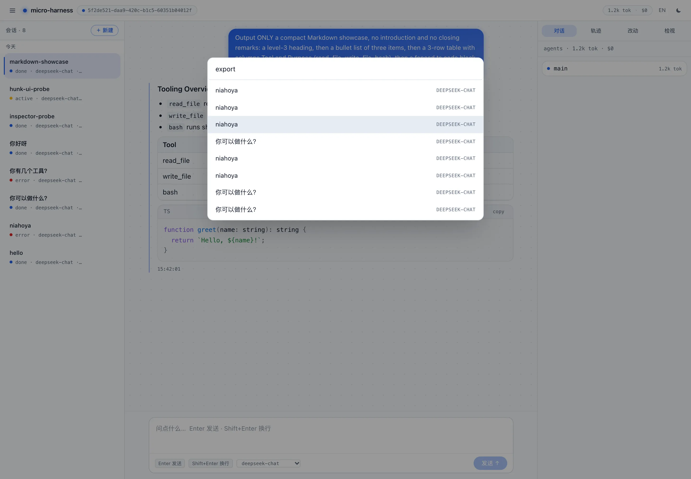
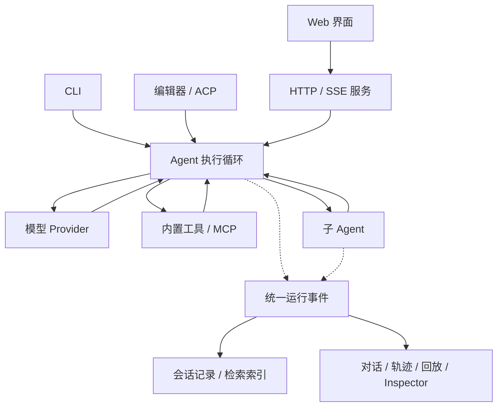
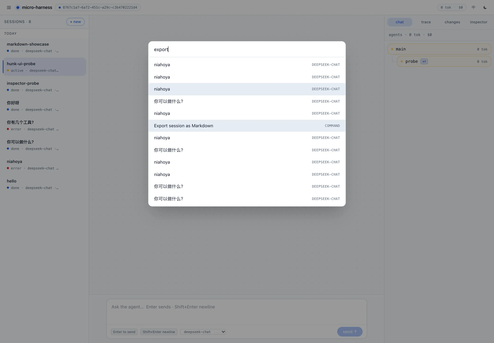
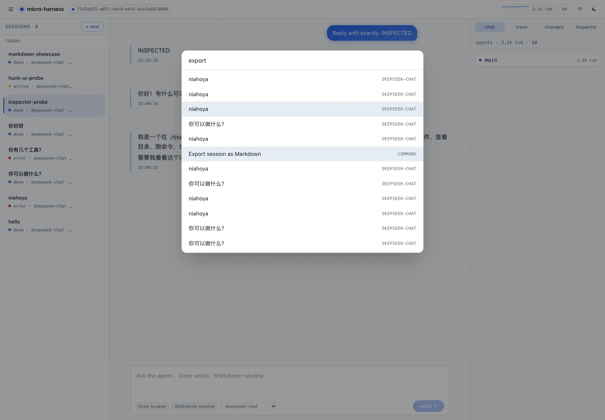

<!-- 品牌图标使用透明背景，适配深浅主题。 -->
<p align="center">
  
</p>

<h1 align="center">micro-harness</h1>

<p align="center"><strong>让模型执行编码任务，也让执行过程清晰可见。</strong></p>
<p align="center">本地运行 · 多 Agent 协作 · 代码改动审阅 · CLI 与 Web 界面</p>

<p align="center">
  <a href="README.md">English</a> · <strong>简体中文</strong> · <a href="https://alexzhangupupup.github.io/micro-harness/">文档站</a>
</p>

<p align="center">
  <a href="https://github.com/AlexZhangUPUPUP/micro-harness/actions/workflows/ci.yml"></a>
  
  <a href="LICENSE"></a>
</p>

micro-harness 是一个用 TypeScript 构建的编码 Agent 运行时。**Agent harness** 是模型与项目之间的那一层：它跑工具循环、管理上下文窗口、记录发生过什么。这个 harness 小到可以读完——**4 个包、约 1.2 万行、零运行时依赖**，模型与循环之间没有框架。

接入任意兼容 OpenAI Chat Completions 的模型服务，它就能读取项目、修改文件、运行工具，并把任务交给子 Agent。CLI、HTTP 服务与 Web 界面共享同一内核。最初只有 6 个源文件的种子版本冻结在 [`seed-v1`](https://github.com/AlexZhangUPUPUP/micro-harness/tree/seed-v1)，是理解循环最短的路径。

<!-- 星标动图链接到仓库，点击图片不会自动更改账号的 Star 状态。 -->
<p align="center">
  <a href="https://github.com/AlexZhangUPUPUP/micro-harness">
    
  </a>
</p>

<p align="center">如果这个项目对你有帮助，欢迎点个 Star。</p>

## 为什么使用它

- **内核可读。** 循环、工具调度、上下文裁剪与事件流都是 `packages/core` 里的普通代码（约 5000 行）。没有插件容器、没有框架——可以从 `send()` 一路跟到模型调用再跟回来。
- **一条事件流，四个视图。** 同一批带标签的事件既是会话日志，也是 SSE、回放、Trace 与 Inspector 的数据源。“模型看到了什么”是被记录下来的，而不是从另一套 UI 状态反推的。
- **能力即权限模型。** `read-only` / `workspace` / `full` / `auto-review` 决定哪些工具存在、有没有 shell、`network` 工具是否逐次审批。
- **带审阅的委派。** 子 Agent 拥有独立上下文（可选独立 git worktree）；改动逐块落地，上下文漂移的 hunk 会被报告而不是错应用。
- **测试与评测是一等公民。** 299 个测试、26 个评测任务、确定性的 `--mock`、带裁判校准的金标集——全部可离线跑。

### 当前能力边界

当前实现已经覆盖长时间本地运行所需的可靠性和审查闭环：

- **运行生命周期：** 共享 Token/成本预算、取消传播、审批释放、幂等恢复、启动恢复诊断和明确的终态。
- **上下文与 Agent 契约：** 独立任务证据、检查点快照、有界搜索与验证工具、验收检查、产物检查，以及可独立报告的子 Agent 结果。
- **可审查执行：** 隔离 worktree、只读 worktree 生命周期检查、分块集成、带 SHA-256 和 HTTP Range 的产物存储，以及分页事件回放。
- **运行与互操作：** SQLite 事务会话源、FTS5 检索、带游标和慢消费者保护的 SSE、Provider 能力检查、MCP 取消/重连、ACP，以及 Ubuntu/macOS CI。

发布边界和已知平台限制见[支持矩阵](docs/support-matrix.zh-CN.md)、[变更记录](CHANGELOG.md)与[版本计划](docs/version-plan.zh-CN.md)。

<!-- 产品静态截图独立展示，避免与星标引导混淆。 -->
<p align="center">
  
</p>

<p align="center"><em>在一个界面里提交任务、跟踪执行、查看结果。</em></p>

[核心设计](#核心设计) · [与同类项目的区别](#与同类项目的区别) · [快速开始](#快速开始) · [CLI 与编辑器](#cli-与编辑器) · [多-agent-协作](#多-agent-协作) · [配置与限制](#配置与限制) · [测试与评测](#测试与评测) · [架构与文档](#架构与文档) · [开发与贡献](#开发与贡献)

## 核心设计

| 设计 | 如何工作 | 实现入口 |
|---|---|---|
| **统一的运行事件** | 模型请求、工具结果、用量与子 Agent 状态通过带有 Agent 标识的事件传递；日志、SSE 与界面消费这些事件。 | [事件定义](packages/core/src/events.ts)、[执行循环](packages/core/src/harness.ts) |
| **可替换的能力接口** | 循环通过 `Provider` 调用模型，通过 `Tool` 执行操作，通过 `FileSystem` 访问文件；能力在代码中显式组装。 | [模型接口](packages/core/src/provider.ts)、[工具接口](packages/core/src/tools.ts)、[文件系统接口](packages/core/src/fs.ts) |
| **独立上下文管理** | 工作窗口统一处理请求预算、工具配对、结构化摘要和 checkpoint 恢复。首轮要求优先保留，过大的工具历史按完整步骤裁剪；不可裁内容超出估算预算时明确失败。 | [上下文模块](packages/core/src/context/README.md)、[机制测试](packages/core/test/context.test.ts) |
| **分离协作状态与代码改动** | 子 Agent 使用独立对话上下文；可选 Git worktree 分离工作目录，再通过 diff 与逐块应用整合改动。具体边界见[配置说明](#配置与限制)。 | [Agent runner](packages/core/src/agents.ts)、[隔离与整合](packages/core/src/isolation.ts)、[补丁应用](packages/core/src/patch.ts) |

项目指令放在工作目录里：如果存在 `AGENTS.md`，其内容会追加到系统提示词（上限 8,000 字符）。Inspector 会显示某次运行实际收到的完整提示词，可据此核对模型被告知了什么。`prompts/` 或 `commands/` 下的提示词模板会以 `/name` 出现在输入框（`/name args` 由服务端展开），`skills/<name>/SKILL.md` 里的技能会追加到系统提示词；CLI 与 Web 读取同一批文件。

从入口到运行记录，执行链路如下。实线表示请求或执行关系，虚线表示事件输出。



## 与同类项目的区别

不同的 harness 在同一个问题上优化不同的部分：Codex 有操作系统级沙箱，Claude Code 的产品面最完整，pi 的运行时扩展面最大，opencode 的客户端/服务端拆分最完整。DeepSeek Harness（dsh）则以 Cordis 插件运行时组织能力，连 Agent 循环也可替换。这里的差别在内核。

| | micro-harness | DeepSeek Harness（dsh） | pi | Codex | Claude Code | opencode |
|---|---|---|---|---|---|---|
| **内核** | ~1.2 万行 TS，4 个包，零运行时依赖 | Cordis 插件运行时 | 小型 TS 循环 + 扩展 API | Rust `core` + `tui`/`exec`/`app-server` | 闭源 | TS server + protocol + 客户端 |
| **谁拥有循环** | `Harness` | `core/agent-loop` 默认驱动，可通过插件替换 | 是，刻意保持小 | `codex-core` | — | server |
| **扩展单位** | 编译期接口 + 启动时读 MCP | Cordis 插件 + profiles / bundles 配置组装 | 启动时注册的 TS 扩展 | MCP + `AGENTS.md` + 配置 | hooks / skills / sub-agents | 插件 + server 协议 |
| **事件** | 一条流 = 日志、SSE、回放、Inspector | 持久会话事件 + 运行中扩展事件 | 会话 JSONL + RPC/SDK | `app-server` JSON-RPC | — | server 协议 |
| **边界** | 预设 × 审批 × 工具 `network` 标记 | sandbox 后端 + 工具执行策略 | 由扩展决定 | OS 沙箱 + 审批 | 权限模式 | 配置 |
| **集成面** | CLI · server + GUI · ACP · MCP | Web · headless · SDK · ACP · desktop | TUI · RPC · SDK | CLI · TUI · app-server · MCP | CLI · IDE | CLI/TUI · desktop · server |

DeepSeek Harness 列核对于 **2026-10-17**，依据其[官方架构文档](https://github.com/deepseek-ai/deepseek-harness/blob/master/docs/architecture.md)。它与本项目都重视事件和能力接口；主要差别是 dsh 通过插件与配置组合运行时，本项目在代码中显式组装接口。

`—` 表示该项目没有公开说明，不代表它没有这个能力。这是一份有时间点的快照，欢迎纠错。

**不构成区别的**：有 server + SSE（opencode 也有）、支持 MCP（Codex 与 Claude Code 也有）、能扩展（pi 的扩展面大得多）。**构成区别的**：内核小到可以读完；用编译期接缝代替插件运行时——因此按设计不支持热插拔；以及一条同时充当日志、回放源与 UI 数据源的事件流。[设计笔记](docs/design-comparison.zh-CN.md)逐个问题展开了这些取舍。

## 快速开始

需要 [Bun](https://bun.sh) 1.4.3，以及模型服务的 API Key。使用 worktree 隔离时还需要 Git，目标项目应为 Git 仓库。支持的平台基线见[支持矩阵](docs/support-matrix.zh-CN.md)。

### 1. 下载并配置模型

```bash
# 下载项目并安装依赖。
git clone https://github.com/AlexZhangUPUPUP/micro-harness.git
cd micro-harness
bun install --frozen-lockfile

# 以 DeepSeek 为例，替换为你自己的 API Key。
export MICRO_BASE_URL=https://api.deepseek.com
export MICRO_API_KEY=your-api-key
export MICRO_MODEL=deepseek-chat
```

使用其他兼容服务时，同时更换地址、Key 和模型 ID；例如 OpenAI 的地址为 `https://api.openai.com/v1`。配置字段可参考 [.env.example](.env.example)。

### 2. 启动 Web 界面

```bash
# 自动审查：shell 可用，但每条命令都要先确认。
MICRO_PERMISSION=auto-review bun run ui
```

首次启动会构建界面，然后自动打开浏览器，默认地址为 `http://127.0.0.1:8787`。端口被占用时会选择其他端口，以终端打印的地址为准；用输入框里的**停止**按钮（或 `Esc`）中断一次运行，按 `Ctrl-C` 停止服务。

输入一个简单任务：

> 创建 hello.txt，写入 hello from micro-harness，然后读取文件并告诉我内容。

完成后，工作目录中应出现 `hello.txt`，对话里可以看到文件写入、读取和最终回复。默认工作目录是启动命令时所在的目录；启动信息中的 `cwd` 会显示实际位置。

### 3. 用于自己的项目

在 micro-harness 仓库中运行，指定目标项目的绝对路径：

```bash
# 将路径替换为你的项目目录。
MICRO_CWD=/absolute/path/to/your-project MICRO_PERMISSION=auto-review bun run ui
```

也可以安装两个启动命令：

```bash
# 默认安装到 ~/.local/bin；该目录需要在 PATH 中。
./scripts/install.sh

# 进入目标项目，再启动界面。
cd /absolute/path/to/your-project
MICRO_PERMISSION=auto-review microh
```

`micro-harness` 是编译后的 CLI；`microh` 是指向当前源码仓库的 Web 启动脚本，仍需要 Bun 和该仓库。

### 把工具提供给别的 agent

`micro-harness mcp` 通过 stdio 说 MCP，别的 agent（或任意 MCP 客户端）就能调用这个 harness 的文件工具——正好和上面的编辑器方向相反。

```bash
# 只暴露文件工具；外部调用默认没有 shell、也没有网络
micro-harness mcp --dir /absolute/path/to/your-project

# 显式加上 shell / 网络
micro-harness mcp --dir /absolute/path/to/your-project --allow-bash --allow-net
```

按普通 stdio MCP server 注册即可（`command: "micro-harness"`，`args: ["mcp", "--dir", "…"]`）。

### 一次运行记录什么

以快速开始中的文件任务为例：模型发出 `write_file` 调用，运行时执行后将结果交回模型；随后读取文件，最后生成回复。具体工具顺序由模型决定。

每轮的 `model.request` 记录裁剪后交给 Provider 的消息与工具名称，`tool.call` / `tool.result` 记录参数、输出与耗时，`usage` 记录服务商返回的用量。你可以对照 Inspector、Trace 与磁盘文件，检查模型看到了什么、实际做了什么。

## CLI 与编辑器

### 在终端中使用

在仓库根目录运行：

```bash
# 执行一次任务，或进入交互模式。
bun start "阅读项目，概括入口文件和主要模块"
bun start

# shell 默认开启；auto-edit 会在每条命令前询问。
bun start "运行相关测试，分析失败原因"

# 指定目标项目。
bun start --dir /absolute/path/to/your-project "解释这个项目的结构"
```

安装后可用 `micro-harness` 替代 `bun start`。完整参数见 `bun start --help`；交互模式输入 `/help`，可查看命令、提示词模板与 skills 入口。

### 通过编辑器使用

项目提供 ACP（Agent Client Protocol）入口，让支持该协议的编辑器驱动 Agent：

```bash
# 通过包装脚本启动，适合由编辑器调用。
/absolute/path/to/micro-harness/scripts/acp.sh
```

<details>
<summary>Zed 自定义 Agent 配置示例</summary>

将下面的路径替换为本机仓库的绝对路径。包装脚本会读取 `~/.micro-harness/env`；没有可用 Key 时，还会尝试读取 `~/.pi/agent/auth.json` 中的 DeepSeek Key。

```json
{
  "agent_servers": {
    "micro-harness": {
      "type": "custom",
      "command": "/absolute/path/to/micro-harness/scripts/acp.sh",
      "args": []
    }
  }
}
```

在 Agent Panel 中选择 `micro-harness` 新建会话。客户端声明文件读写能力时，Agent 可通过编辑器读取和修改文件，包括未保存的缓冲区；目录列表仍从本地磁盘读取。

</details>

## 多 Agent 协作

主 Agent 通过 `task` 工具分派工作。每个子 Agent 使用独立的对话上下文，接收任务描述，并将最终结果返回给主 Agent。它适合拆分代码调研、独立模块实现或多种方案的探索。

**上下文隔离默认存在，文件隔离需要另行开启。** 要让子 Agent 在各自的 Git worktree 中工作：

```bash
# 在 Git 项目上启用隔离，并打开 Web 界面。
MICRO_CWD=/absolute/path/to/your-project MICRO_ISOLATE=1 MICRO_PERMISSION=auto-review bun run ui

# CLI 中使用对应参数，完成后打印 Agent 树。
bun start --dir /absolute/path/to/your-project --isolate --tree "将任务拆分给子 Agent，分别处理后汇总"
```

开启后，可以在 Agents 面板跟踪执行，在 Changes 面板检查各自的 diff，选择要应用的代码块。提示词可以描述如何分工，实际是否调用子 Agent 由模型决定。

| 代码改动审阅 | 模型调用检查 |
|---|---|
|  |  |

CLI 还提供 `--max-depth`、`--max-concurrency`、`--agent-timeout`、`--agent-max-tokens` 和 `--agent-max-cost`，用于限制子 Agent 的执行规模。

## 配置与限制

| 配置 | 用途 |
|---|---|
| `MICRO_BASE_URL` / `MICRO_API_KEY` / `MICRO_MODEL` | 模型服务地址、凭证与模型 ID |
| `MICRO_CWD` | Web 服务的工作目录；CLI 使用 `--dir` |
| `MICRO_MODELS` | Web 模型选择器中的模型 ID，以逗号分隔 |
| `MICRO_PERMISSION` | Web 权限预设：`read-only`、`workspace`、`full`、`auto-review` |
| `MICRO_ISOLATE=1` | 为子 Agent 请求 Git worktree 隔离；CLI 使用 `--isolate` |
| `MICRO_DATA_DIR` | Web 会话与索引存储目录，默认 `~/.micro-harness` |
| `MICRO_HOST` / `MICRO_PORT` / `MICRO_SERVER_TOKEN` | 服务监听地址、起始端口与 API 鉴权 |
| `MICRO_WEB` | Web 服务内置联网工具：`off`、`fetch`、`search`、`all`，默认 `all` |
| `MICRO_SEARCH_PROVIDER` | 默认搜索引擎：`bing`、`deepseek`、`baidu`、`bocha`、`searxng` |
| `MICRO_PRICE_INPUT` / `MICRO_PRICE_OUTPUT` / `MICRO_PRICE_INPUT_CACHED` | 每百万 token 的美元价格，用于成本估算 |
| `MICRO_MAX_COST` | 单次运行累计成本超过这个美元数后停止 |
| `MICRO_SANDBOX` | shell 沙箱：`off`（默认）、`auto`、`require`（macOS 用 Seatbelt，Linux 用 bwrap） |
| `MICRO_SANDBOX_SECRETS` | `deny`（默认）从沙箱 shell 中隐藏 `~/.ssh` 等目录并清洗密钥类环境变量；`allow` 关闭该保护 |

模型费用由所接入的服务商收取。成本显示依赖配置的价格与服务商返回的用量。

**权限。** 预设把“能碰什么”和“要不要问”绑在一起：`read-only` 与 `workspace` 没有 shell、也没有 `network` 工具；`full` 两者都有；`auto-review` 两者都有，但每条 shell 命令与联网调用都要先确认。`bun run ui` 与 `microh` 默认 `full`（示例使用 `auto-review`）；CLI 默认开启 shell，审批默认 `auto-edit`；加 `--no-bash` 可关闭。Web 界面可切换会话预设，下一次运行生效。运行中发送新消息会中断当前运行，并从已记录的历史开始新一轮。

**限制。**

- **默认没有操作系统级沙箱。** 路径检查与 Git worktree 只用于限定操作范围、分离改动，不是安全边界。可选的操作系统级沙箱（`--sandbox=auto|require`、`MICRO_SANDBOX`）会把 shell 命令限制在工作区（外加 `/tmp` 与 `/dev`），默认断网，传 `--sandbox-net` 才放行网络：macOS 用 Seatbelt，Linux 用 bubblewrap（`bwrap`，需要非特权 user namespace）。沙箱内默认隐藏 `~/.ssh`、`~/.aws`、`~/.config/gh` 等凭证目录并清洗密钥类环境变量；`--sandbox-secrets=allow` 可关闭（沙箱内 `git push` 读 `~/.ssh` 就需要它）。符号链接会先解析再做检查，指向目录外的链接会被拒绝。显式启用 worktree 隔离时，目标目录必须是已有提交的 Git 仓库；隔离创建失败会停止子任务并返回原因，不会退回共享目录。
- **工具权限依赖能力声明。** `read-only` 会过滤声明为可写的外部工具；MCP 适配器遵循 `readOnlyHint`，未声明的按可写处理，因此只读会话无法调用。其他预设下，外部工具的文件访问范围仍由其服务端负责。
- **MCP 不支持热插拔。** 配置在启动时读取，改完 `mcp.json` 需重启。
- **成本是估算**，取决于你配置的价格；图片输入需要支持视觉的模型。
- **早期版本（v0.1）**，接口可能在小版本间变化。

### 外部工具与联网

通过 MCP（Model Context Protocol）接入外部工具，支持 stdio 与 HTTP。配置在启动时加载，修改后需要重启。下面是 `.micro-harness/mcp.json` 的最小示例；也支持 `.mcp.json`、`~/.micro-harness/mcp.json` 或 `MICRO_MCP_CONFIG` 指定路径。

```json
{
  "mcpServers": {
    "local-tools": {
      "command": "your-mcp-server",
      "args": []
    }
  }
}
```

工具以 `<server>__<tool>` 命名；`GET /api/mcp` 可查看连接状态。`web_search` 与 `web_fetch` 是内核内置工具，可通过界面的联网开关和搜索引擎选择器调整。DeepSeek 需要 `DEEPSEEK_API_KEY`（与对话用的是同一个 key），Bocha 需要 `BOCHA_API_KEY`，SearXNG 需要 `MICRO_SEARXNG_URL`。同一 URL 的重复抓取会缓存五分钟。

## 测试与评测

上下文管理需要同时处理窗口长度与消息结构。下面用例写明输入与断言，无需模型 Key 即可运行。

| 检查 | 输入或条件 | 用例断言 |
|---|---|---|
| 单轮长任务 | 一条用户消息、20 个工具步骤，每个结果含 4,000 个字符，裁剪前估算超过 20,000 tokens | 在该构造用例中裁至不超过 5,000 个估算 tokens；保留任务描述、最新步骤与调用/结果配对 |
| 首轮与近期内容 | 多轮消息触发中间裁剪 | 保留首轮与近期消息，保留部分的内容不被改写 |
| 摘要失败 | 注入会抛出异常的摘要函数 | 回退到确定性的中间裁剪策略 |

```bash
# 离线检查上下文裁剪、消息配对和摘要降级机制。
bun test packages/core/test/context.test.ts

# 用脚本化模型检查“创建文件”和“修复失败测试”两类任务。
bun run eval:mock --tasks=exact-file,fix-failing-test --runs=1
```

上述两组分别检查上下文机制与任务执行。`bun run eval:mock` 会打印确定性汇总：26 个任务 × 2 次 = 52 次尝试，44 通过、0 失败、8 跳过——计分部分 100%。这些是脚本化运行：证明 harness 能执行任务，不代表真实模型能解出。2026-10-19 用 `deepseek-chat` 做的抽查（只用确定性评分任务、每个 1 次）5/5 通过：`exact-file`、`fix-failing-test`、`rename-symbol`、`json-shape`、`append-section`。这是冒烟检查，不是 benchmark；token 数使用本地估算。当前回归门是 `bun run verify`（31 项离线功能检查）、`bun test`（299 个测试）、`bun run typecheck` 和 GUI 生产构建。评测套件仍是 26 个任务，按精确断言或 LLM 裁判评分，另有金标集与裁判校准命令（`--min-accuracy`）用于真实模型评测。真实模型评测、裁判与已知局限见[评测说明](scripts/evals/README.md)。

## 架构与文档

核心运行时负责“请求模型 → 执行工具 → 把结果交回模型”的循环，并发出事件。服务端将事件保存并推送到浏览器，界面据此展示对话、Agent 树与运行详情。

| 目录 | 职责 |
|---|---|
| [`packages/core`](packages/core) | Agent 循环、内置工具（文件、shell、联网搜索/抓取）、上下文管理、多 Agent、CLI、MCP 与 ACP |
| [`packages/server`](packages/server) | HTTP API、SSE 事件推送、会话存储与全文检索 |
| [`packages/gui`](packages/gui) | React Web 界面、对话、轨迹、改动审阅与 Inspector |

### 两个设计取舍

**接口扩展，显式组装。** 模型、工具与文件系统通过接口替换，在 CLI 或服务端入口完成组装。当前 MCP 配置在启动时加载，不提供运行中热插拔；这一边界让执行循环不必承担插件生命周期管理。取舍依据见[设计对比](docs/design-comparison.zh-CN.md)。

**记录与检索分开。** Web 会话将事件和元数据以事务方式写入 SQLite，并维护 FTS5 检索索引；JSONL 保留为可读、可移植的兼容导出。数据库可从既有会话记录修复，导出也可从 SQLite 重新生成。实现见[会话存储](packages/server/src/store.ts)与离线[存储命令](packages/server/src/storage-cli.ts)。

继续了解实现、评测与项目演进：

| 文档 | 适合了解什么 |
|---|---|
| [架构说明](ARCHITECTURE.md) | 模块划分、数据流与设计基线 |
| [设计对比](docs/design-comparison.zh-CN.md) | 与其他 harness 的设计对照，以及采用或舍弃某种机制的原因 |
| [评测说明（英文）](scripts/evals/README.md) | 任务集、评分方法、上下文实验与评测局限 |
| [路线图](ROADMAP.md) / [构建记录](PROGRESS.md) | 项目演进与阶段记录；历史状态以当前代码为准 |
| [变更记录](CHANGELOG.md) | 版本发布说明与当前未发布变更 |
| [支持矩阵](docs/support-matrix.zh-CN.md) | 运行时、平台、协议与 CI 支持边界 |
| [版本计划](docs/version-plan.zh-CN.md) | 版本波次、发布门槛与后续工作 |
| [极简种子 seed-v1](https://github.com/AlexZhangUPUPUP/micro-harness/tree/seed-v1) | 从六个源码文件理解最初的 Agent 循环；该版本使用 Node ≥ 22.18 |

## 开发与贡献

```bash
# 基础检查：测试、类型检查与离线功能验证。
bun test
bun run typecheck
bun run verify

# 使用脚本化模型运行评测，不调用真实模型。
bun run eval:mock

# 构建文档站与 Web 界面。
bun run docs:build
cd packages/gui && bun run build
```

在仓库根目录运行 `bun run dev`，可分别启动 API 服务与 Vite preview；它服务构建产物，不提供源码热更新。需要前端热更新时，在 API 已运行的情况下进入 `packages/gui` 执行 `bun run dev`，并按 [Vite 配置](packages/gui/vite.config.mts) 设置后端地址。

欢迎提交 issue 与 PR。请说明要解决的问题、预期行为和验证方式；行为修改应带相关测试。真实模型评测会调用外部服务并产生费用，运行方式与限制见[评测说明](scripts/evals/README.md)。

## 许可与致谢

采用 [MIT License](LICENSE)。最初的种子源自 [PiStudio](https://github.com/AlexZhangUPUPUP/PiStudio)，worktree 与合并队列的实现也延续了其中的设计。
