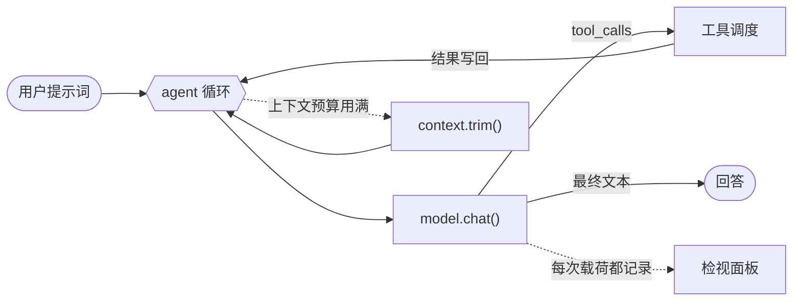
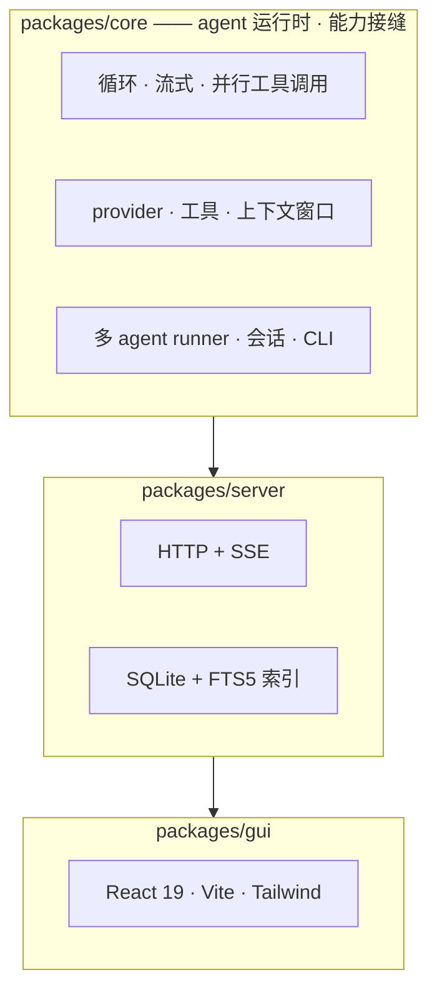
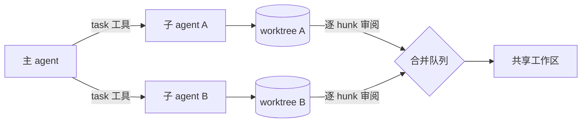

<h1 align="center">micro-harness</h1>

<p align="center">
  <a href="README.md"></a>
  <a href="README.zh-CN.md"></a>
</p>

<p align="center"><strong>一个基于插件的编码 agent 平台 —— 自带 agent 循环、多 agent 编排、HTTP/SSE 服务端、CLI 与 Web GUI。</strong></p>

<p align="center">
  
  
  
  
  
  
  
</p>

> 🌱 原始的**极简种子**——六个源码文件、零依赖、无构建步骤，Node ≥ 22.18 直接运行——已冻结在 [`seed-v1`](https://github.com/AlexZhangUPUPUP/micro-harness/tree/seed-v1) 这个 tag 上。想理解核心，就从那份从头读到尾；当前分支是在它之上长出来的平台。

---

## 📑 目录

- [✨ 这是什么](#-这是什么)
- [🆚 与其他 harness 的区别](#-与其他-harness-的区别)
- [📸 效果预览](#-效果预览)
- [🚀 快速开始](#-快速开始)
- [🧩 架构](#-架构)
- [🤖 多 agent](#-多-agent)
- [🔌 MCP](#-mcp)
- [🧩 ACP —— 让编辑器驱动我们](#-acp--让编辑器驱动我们)
- [🖥 GUI](#-gui)
- [📐 设计原则](#-设计原则)
- [📁 仓库结构](#-仓库结构)
- [🗺 路线图](#-路线图)
- [🧪 开发](#-开发)
- [🤝 参与贡献](#-参与贡献)
- [📄 许可](#-许可)

---

## ✨ 这是什么

**agent harness**（agent 运行时）是把 LLM 变成 agent 的那层：它跑循环、执行工具、管理上下文窗口、跟模型对话。很多被归功于「模型」的行为，其实发生在这里。

这个仓库就是其中之一，并且长成了一个平台——同时保持可读：



| | |
|---|---|
| **事件是唯一契约** | 循环只产出一条带标签的事件流。会话日志、服务端 SSE、CLI、轨迹面板、回放、agent 树和检视面板都只是它的消费者——没有旁路。 |
| **要接缝，不要容器** | 扩展点是**编译期接口**——`Provider`、`Tool`、`FileSystem`、`AgentRole`、`AgentEvent`——装配是显式代码（`createServer`、`makeTools`）。我们先做了一个 DI 容器，量出它（**25** 个装配点、**0** 个运行时消费者），然后[把它删了](docs/design-comparison.zh-CN.md)。 |
| **多 agent 是一等公民** | `task` 工具支持 `single`/`parallel`/`chain`/`race` 四种模式，真正的上下文隔离，以及深度/并发/token/成本四重上限。不是外挂上去的。 |
| **隔离之后还有审阅** | 每个子 agent 拿到自己的 git worktree，并行 agent 不会互相覆盖——而且结果可以**逐 hunk**决定应用哪些。 |
| **默认可观测** | 滚动的 token/成本、agent 树、回放拖动条，以及能看到「实际发给模型的载荷」的检视面板。 |

---

## 📸 效果预览

### 💬 对话——流式、Markdown、实时用量

> 助手消息按 Markdown 渲染，代码块带语法高亮和一键复制。实时用量以滚动数字 + 迷你折线展示，会话按天分组，`⌘K` 打开命令面板并对所有已保存会话做全文检索。


### 🌏 中英双语

> English 与 简体中文，用 `中 / EN` 按钮原地切换（首次访问跟随浏览器语言）。


### 🤝 隔离与逐 hunk 审阅

> 打开 `MICRO_ISOLATE=1` 后，每个子 agent 在自己的 git worktree 里干活，并行不会打架。diff 回来时逐 hunk 审阅，只应用你要的部分；上下文已经漂移的 hunk 会被报告出来，而不是被悄悄错误应用。


### 🔍 轨迹、回放与检视

> 原始事件流带分类过滤和回放拖动条，可以从任意切片重建对话；检视面板则展示每一次调用实际发出的系统提示词、工具 schema 和消息。


---

## 🚀 快速开始

**环境要求：** [Bun](https://bun.sh) ≥ 1.1（平台），或者只要 Node ≥ 22.18（[`seed-v1`](https://github.com/AlexZhangUPUPUP/micro-harness/tree/seed-v1) 那份种子）。任意 OpenAI 兼容端点都行。

```bash
git clone https://github.com/AlexZhangUPUPUP/micro-harness.git
cd micro-harness
bun install

export MICRO_BASE_URL=https://api.deepseek.com   # 任意 OpenAI 兼容端点
export MICRO_API_KEY=sk-...
export MICRO_MODEL=deepseek-chat                 # 用厂商真实的模型 id
```

**跑 agent**（CLI 在 `packages/core/src/cli.ts`）：

```bash
bun start "创建 hello.txt 写入 'hi'，然后读回来打印内容"
bun start --allow-bash "找出最大的 3 个文件并总结"
bun start --isolate --tree "…"   # 每个子 agent 一个 git worktree，结束打印 agent 树
bun start                        # 交互式 REPL：/help、提示词模板、skills
```

**安装二进制**（一条命令，无需发布）：

```bash
./scripts/install.sh                 # → ~/.local/bin/micro-harness
micro-harness --version              # 0.1.0
```

**跑整套**——服务端、GUI，并自动找到可用的 key：

```bash
bun run ui                       # 单进程：服务端顺便托管 GUI  → http://127.0.0.1:8787
bun run dev                      # 两进程（server + Vite preview）→ http://127.0.0.1:5273
```

两者都会自动开浏览器（`scripts/dev.sh --no-open` 可关）；`MICRO_ISOLATE=1` 让每个子 agent 各用一个 git worktree。

在**任意目录**都能启动：agent 就在你启动的那个目录里干活，端口自动挑一个空的（多个终端可各跑一个），**关掉终端就全部结束**。`microh` 是从任意位置做同样的事（由 `scripts/install.sh` 安装）。

<details>
<summary>全部 CLI 参数与环境变量</summary>

| 参数 | 含义 |
|---|---|
| `--dir <path>` | 工具被沙箱限制的工作目录（默认 `.`） |
| `--model <id>` / `--base-url <url>` | 覆盖环境变量里的配置 |
| `--approval <mode>` | `suggest` / `auto-edit` / `full-auto`（默认） |
| `--allow-bash` | 启用 `bash` 工具（默认关闭） |
| `--isolate` | 每个子 agent 一个独立 git worktree |
| `--tree` | 运行结束后打印 agent 树 |
| `--max-steps <n>` / `--max-context <n>` | 循环步数（24）/ 上下文预算（24000） |
| `--trace` | 把每个事件追加到 JSONL 轨迹文件 |
| `--quiet` | 不打印工具活动 |

| 环境变量 | 含义 |
|---|---|
| `MICRO_MODEL` / `MICRO_BASE_URL` / `MICRO_API_KEY` | 模型 provider |
| `MICRO_MODELS` | 逗号分隔的模型列表，由 `GET /api/models` 暴露（GUI 的模型选择器） |
| `MICRO_DATA_DIR` | 会话与索引目录（默认 `~/.micro-harness`） |
| `MICRO_ISOLATE` | `1` → 每个子 agent 一个 git worktree |
| `MICRO_APPROVAL` | `full-auto`（默认）/ `auto-edit` / `suggest`——只要不是 `full-auto`，就会通过 GUI 或 ACP 客户端征求批准 |
| `MICRO_PORT` / `MICRO_HOST` / `MICRO_SERVER_TOKEN` | 服务端监听与鉴权 |
| `MICRO_PRICE_INPUT` / `MICRO_PRICE_OUTPUT` | 每 100 万 token 的美元价格，用于成本统计 |
| `MICRO_ALLOW_BASH` | `1` → 服务端也启用 `bash` |

`dev.sh` 会打印它最终用了哪把 key——`key sk-41cdf912… (from ~/.pi/agent/auth.json)`——并在环境变量里的 key 与 `auth.json` 不一致时给出警告；否则那会变成一个很久之后才以 `402 Insufficient Balance` 现形的困惑。

</details>

---

## 🆚 与其他 harness 的区别

每个 harness 的 README 都在暗示"我们才是好的那个"。这一份选择把过程摊开：我们从
**DeepSeek Harness**、**pi**、**Claude Code**、**Codex** 各自抄了什么、刻意拒绝了什么、
以及我们不确定的地方。被删掉的那个 DI 容器也住在那里——连同支持删除它的那些测量数字。

**→ [docs/design-comparison.zh-CN.md](docs/design-comparison.zh-CN.md)**

---

## 🧩 架构

三个包，依赖单向。core 不知道 HTTP 是什么，GUI 只读事件流。



| 包 | 它是什么 |
|---|---|
| `packages/core` | 长大后的种子：循环、工具调度、上下文窗口、provider、多 agent runner、会话、CLI。 |
| `packages/server` | Bun HTTP + SSE：会话、流式、FTS5 检索索引、worktree 隔离接口与合并队列。 |
| `packages/gui` | React 19 + Vite + Tailwind。每个视图都由 `lib/derive.ts` 里纯函数、有单测地从事件流派生。 |

---

## 🤖 多 agent

子 agent 是刻意隔离的：它以全新的上下文启动，只拿到你给它的提示词，只返回最终答案。父 agent 不会继承它的噪声。



| 模式 | 行为 |
|---|---|
| `single` | 一个子 agent |
| `parallel` | 并发多个，结果合并 |
| `chain` | 顺序执行，`{previous}` 会被替换成上一个结果 |
| `race` | 并发多个，取第一个成功的结果 |

上限由 runner 强制执行，而不是靠约定：`--max-depth`、`--max-concurrency`、`--agent-timeout`、`--agent-max-tokens`、`--agent-max-cost`。

---

## 🔌 MCP

MCP server 是**启动时从配置读进来**的，工具合并进注册表。整个集成就这么多：没有容器、
没有生命周期管理器，循环、事件契约、GUI 都不知道 MCP 的存在——一个 MCP 工具就只是一个
`Tool`。

```json
// .micro-harness/mcp.json（也可以是 .mcp.json、~/.micro-harness/mcp.json 或 $MICRO_MCP_CONFIG）
{
  "mcpServers": {
    "everything": { "command": "npx", "args": ["-y", "@modelcontextprotocol/server-everything"] },
    "remote":     { "url": "https://example.com/mcp", "headers": { "Authorization": "Bearer …" } }
  }
}
```

两种传输都没有引官方 SDK：**stdio**（拉起子进程，换行分隔的 JSON-RPC）与 **streamable
HTTP**（JSON 或一次性 SSE 回复）；工具按 `<server>__<tool>` 加命名空间，两个 server 可以
同时暴露 `search`。`GET /api/mcp` 报告连上了什么；启动失败的 server 会被报告并跳过，而
不是把整个会话拖垮。

已对着官方参考 server 做过端到端验证：发现 13 个工具，模型连同内置 5 个一起拿到它们，
调用了 `everything__get-sum {a:17,b:25}`，并回答 `42`。

**它刻意不做的事：** 把 server 热插拔进运行中的进程，或者掉线时撤回它的工具。如果哪天这
成了需求，那正是我们写下的"把插件容器请回来"的触发条件——见[对比文档](docs/design-comparison.zh-CN.md)。

---

## 🧩 ACP —— 让编辑器驱动**我们**

MCP 的镜像：`micro-harness acp` 在 stdio 上讲 **Agent Client Protocol**，于是编辑器
（Zed，或任何带 ACP 客户端的工具）可以直接驱动这个 harness。协议版本 1，JSON-RPC，
换行分隔。

| 方向 | 方法 |
|---|---|
| **入**（客户端 → agent） | `initialize` · `session/new` · `session/prompt` · `session/cancel` |
| **出**（agent → 客户端） | `session/update`（流式文本、带 `kind`/`status` 的工具调用、用量与成本） · `session/request_permission` · `fs/read_text_file` / `fs/write_text_file` |

有两件事是从设计里自然长出来的，而不是外挂上去的：

- **审批终于有 UI 了。** `--approval suggest` 会把每个改文件的工具调用通过
  `session/request_permission` 发给编辑器，于是*允许一次 / 总是允许 / 拒绝 / 总是拒绝*
  成了真实选项，而不再是一个缺失的 confirm 钩子。
- **文件系统接缝回本了。** 当客户端声明 `fs.readTextFile` / `fs.writeTextFile` 时，读写
  **走编辑器**——于是 agent 能看到未保存的缓冲区——而 `list` 仍落在本地磁盘，因为 ACP
  没有列目录的原语。正是这种不对称，让 `FileSystem` 必须是一个 provider **对象**而不是
  一个布尔开关。

已用真机验证：把真 CLI 当子进程驱动、接真模型，单个回合产出 101 条 `session/update`
通知（流式文本、4 次工具调用、带成本的用量）；在不声明 fs 能力时，文件确实落盘
（`hello from acp`）。

---

## 🖥 GUI

| 区域 | 它能做什么 |
|---|---|
| **会话** | 按今天/昨天/更早分组，就地重命名，两步删除，实时状态点 |
| **对话** | 流式 Markdown + 高亮代码与复制按钮；悬浮用户消息可**编辑并重发**（在该点分叉会话、跑修改后的提示词，原会话不动） |
| **agents** | 子 agent 树带连线，每节点 token/成本/悬浮详情卡，worktree 徽标，以及 prompt cache 命中徽章（`⚡ cache 2.6k (78%)`） |
| **轨迹** | 原始事件流，带分类 chip、文本过滤和回放拖动条（REPLAY 模式会让界面去饱和） |
| **改动** | 每个 agent 的 diff、**逐 hunk 接受/拒绝**、合并回主干，以及整合全部合并队列 |
| **检视** | 每一次模型调用实际发出的载荷：系统提示词、工具 schema、消息、token 估算 |
| **命令面板** | `⌘K` —— 应用动作 + 所有已保存会话的全文检索 |
| **附件** | 往输入框里粘贴或拖入图片，它会作为多模态内容部分一起发出去 |
| **审批** | 服务端以 `--approval suggest`/`auto-edit` 运行时，改文件的工具调用会阻塞，并在对话里出现「允许 / 拒绝」卡片 |
| **会话树** | 侧栏可切到树形模式，分叉会话嵌在其来源之下 |
| **输入框** | 由 `/api/models` 驱动的模型选择器；一次运行在你没看这个标签页时结束会弹桌面通知 |

| 按键 | 行为 |
|---|---|
| `⌘K` / `Ctrl K` | 命令面板 |
| `⌘/` | 键盘快捷键速查表 |
| `↑` `↓` | 在侧栏或命令面板中移动 |
| `Enter` / `⇧ Enter` | 发送 / 换行 |
| `Esc` | 关闭任意弹窗 |

---

## 📐 设计原则

- **种子零依赖，平台不是。** `seed-v1` 只用 Node 内置模块。当前分支是 Bun 单体仓库——Bun 做工具链、`bun:sqlite` 做索引、React + Vite + Tailwind 做 GUI——不过根 `package.json` 依然没有声明任何运行时依赖。
- **错误也是数据。** 工具失败返回 `{ output, isError: true }`，作为一条普通的 `tool` 消息追加进去，模型看得到失败原因并可以恢复。这正是循环能稳住的关键。
- **压缩是策略，不是常量。** 默认确定性地丢中间；`--compact=summarize` 把被丢掉的轮次换成一段由模型写的摘要（这次调用失败就退回丢弃）。`--max-cost` 让一次运行在无限花钱之前停下。
**实测，带消融对照。** 一次真实会话（DeepSeek，31 次模型调用），刺激设计成躲不掉：第 1 轮埋下
一条磁盘上不存在的不可猜规则（`每个文件都必须以 // PROJECT-CHECK-7Q4 结尾`），随后 6 轮各往
故意设小的窗口（5000 tokens）里灌约 8KB 工具输出，最后一轮要求建一个必须遵守该规则的文件。
判分是二值的——标记在文件里或不在：

| 策略 | 规则是否存活 | 压缩次数 | 丢弃消息 | 压缩后峰值 | 缓存命中 | 成本 |
|---|---|---|---|---|---|---|
| **`drop-middle`**（默认） | **是** | 4 | 16 | 4455 / 5000 | 66% | $0.00596 |
| `tail`（消融：不保留开头） | **否** | 4 | 18 | 4402 / 5000 | 66% | $0.00584 |
| `summarize` | 是 | 4 | 15 | 4762 / 5000 | 64% | $0.00576 |

**消融才是重点**：同一条会话在不保留开头时会丢掉规则，所以"通过"是机制导致的，不是运气。
顺带两个诚实的发现——窗口确实没爆（0 次 API 报错），但**反复压缩会让缓存命中率衰减到约 66%**
（每次裁剪都会搅动前缀）；而 `summarize` 以大致相同的成本保住了规则，只是峰值更高（摘要本身
也占 token）。
- **预算在一次长回合内部也成立。** 压缩通常丢的是整个*回合*，但一次编码运行往往只有一条 user 消息后跟几十次工具调用——根本没有更老的回合可丢。真实 24 回合审计实测：在处理这个之前，上下文峰值达到 **52700 tokens（预算 24000）**且压缩**一次都没触发**；现在回退到丢*步骤*（一条 assistant 加它产生的工具结果，绝不拆散），同一次运行峰值 **23685 / 24000**，触发 7 次压缩。
- **绝不重写过去。** 工具结果是在**写入时**截断的，而不是等窗口满了再动它——这样消息前缀逐字节稳定，而这正是厂商 prompt cache 能命中的前提。真需要压缩时，丢的是**中间**：保留 system prompt 与第一轮用户消息（约束都在那儿）加最新的若干轮，于是 tool 消息永远不会和它的调用拆散，早期指令也不会消失。
- **把经济性量化。** 三家厂商用三个不同的字段名上报缓存命中，这里统一归一化成 `usage.cacheRead`，按缓存价计价（DeepSeek 命中比未命中便宜约 10 倍），并在 GUI 里显示命中率——本仓库的真实运行命中 69–78%。
- **沙箱。** 文件工具会把每个路径解析到 `--dir` 内部并拒绝越界；`bash` 需要显式开启。
- **能力共享，状态隔离。** provider、工具和存储共享；消息、cwd 和策略按会话、按子 agent 隔离。
- **小而可测的纯函数。** diff 解析、hunk 选择、对话派生、会话分组、用量序列都是纯函数且有单测——UI 只负责渲染它们。

---

## 📁 仓库结构

```
micro-harness/
├── packages/
│   ├── core/                    # agent 循环、工具、上下文、provider、多 agent、CLI
│   ├── server/                  # HTTP + SSE + SQLite/FTS5 索引
│   └── gui/                     # React 19 + Vite + Tailwind
├── scripts/
│   ├── dev.sh                   # 一条命令：服务端 + GUI + key 解析
│   ├── verify-features.ts       # 脚本化端到端功能自检（不走网络）
│   └── auto-run.sh              # 无人值守驱动
├── docs/                        # 本 README 用到的截图
├── ARCHITECTURE.md              # 设计基线
├── ROADMAP.md                   # P0–P10 规划
└── PROGRESS.md                  # 构建日志
```

---

## 🗺 路线图

- [x] **P0 · 基座** —— monorepo、Bun 工具链、CI
- [x] ~~**P1 · 内核** —— 服务/DI、生命周期、作用域、事件总线~~ **已回退**：做出来了（396 行 + 10 个测试），量出**0** 个运行时消费者，于是删除，改用编译期接缝。见[对比文档](docs/design-comparison.zh-CN.md)。
- [x] **P2 · 事件化 core** —— `AgentEvent`、流式、并行工具调用、审批模式、会话
- [x] **P3 · 多 agent** —— runner、`task` 工具、上下文防火墙、多重上限
- [x] **P4 · Server** —— HTTP + SSE、会话 API、SQLite/FTS5 索引
- [x] **P5 · CLI** —— 一次性执行、REPL、斜杠命令、提示词模板、skills
- [x] **P6 · GUI** —— 会话、对话、agent 树、轨迹 + 回放、改动
- [x] **P7 · 隔离** —— 每个 agent 一个 git worktree、合并回主干、合并队列
- [x] **P8 · 互操作** —— MCP client、ACP server
- [x] **P9 · 上下文与经济性** —— 压缩策略、cache-prefix 复用、成本计量
- [x] **P10 · 评测与发布** —— 评测集（26 个任务、金标集 + 裁判校准）、`bun build --compile`、`scripts/install.sh`
- [ ] **P10 · 文档站** —— 托管文档站（npm 发布经决定跳过）

---

## 🧪 开发

```bash
bun install
bun test              # 153 个测试，21 个文件
bun run typecheck     # tsc --noEmit，干净
bun run verify        # 脚本化功能自检（不走网络）
bun run eval:mock      # 评测套件跑脚本化 provider —— CI 友好、不走网络
bun run eval --judge   # 同一套任务 + 对开放式任务引入 LLM 裁判
```

测试覆盖事件循环与流式、并行工具调用与审批、会话回放、多 agent 上限与上下文防火墙、MCP 与 ACP、服务端接口与 JSONL/SQLite 存储、worktree 隔离与合并队列、针对真实 `git diff` 输出的分片补丁应用，以及 GUI 渲染所依赖的每一个纯函数派生。

---

## 🤝 参与贡献

欢迎提 issue 和 PR。如果想找切入点，路线图里剩余的一项（**P10 · 文档站**；npm 发布经决定跳过）以及标了 *good first issue* 的都合适。

两件事能让 PR 更容易被合：

1. `bun test` 与 `bun run typecheck` 通过。
2. 新行为带上「本来能抓到它的那个测试」——大量逻辑集中在 `packages/core/src` 与 `packages/gui/src/lib/derive.ts` 的纯函数里，测起来很便宜。

---

## 📄 许可

[MIT](LICENSE)。

`seed-v1` 上的种子源自 [PiStudio](https://github.com/AlexZhangUPUPUP/PiStudio)；`packages/core/src` 里 worktree 与合并队列的移植仍带着这层血脉。

---

## ⭐ Star 历史

<a href="https://star-history.com/#AlexZhangUPUPUP/micro-harness&Date">
  
</a>
